# Jukebox Kiosk (`ha-jukebox-kiosk`) 0.8.1

> This README covers the integration and the card bundled in it. Since 0.7.9 the card works only through the Jukebox Kiosk integration (or, with fewer features, the official Music Assistant integration); mass_queue support is gone.

Jukebox Kiosk is a Home Assistant integration that ships the **Jukebox Card**, a Lovelace card for a Home Assistant + Music Assistant jukebox kiosk. It also gives the card its own WebSocket API to Music Assistant.

- **One install.** Setting up the integration serves the card from `/jukebox_kiosk_static/jukebox-card.js` and loads it on every dashboard. You don't add a resource, and there are no font files to install.
- **Its own Music Assistant API.** The integration borrows the connection the official Music Assistant integration already holds and exposes it as `jukebox_kiosk/*` WebSocket commands. It forwards only an allowlist of Music Assistant commands, and every one is checked against the calling Home Assistant user (see [Permissions](#permissions)).
- **Every card feature through one integration.** Queue reading and editing (Play Now, Play Next, Move, Remove with Undo), album/artist/playlist/podcast track lists with server-side paging, lyrics, speaker grouping and transfer, and favourites.
- **Live queue.** The card subscribes to queue changes (`jukebox_kiosk/subscribe_queue`) instead of polling.

The card's element is still `custom:jukebox-card`, so existing dashboards keep working. Version history is in [CHANGELOG.md](CHANGELOG.md), and building and tests are in [docs/DEVELOPMENT.md](docs/DEVELOPMENT.md).

## Screenshots

> Some of these pictures were taken before 0.7.20. Since 0.7.20 the Library lists show as rows by default (not tiles, and artists are no longer round), and the row buttons (Add to queue, Play Next, Play Now, Remove and so on) are hidden by default. The pictures still show tiles and the buttons.

> Since 0.8.0 the card follows your Home Assistant theme, so colors, corners and fonts come from the theme, in light and in dark. Since 0.8.1 Now Playing has no album-art background unless you choose one (see [Backdrop and performance](#backdrop-and-performance)). The Now Playing, Library, Library typing, Library artists, Queue, Queue pop-up, Speakers and Now Playing background pictures below were retaken for 0.8.1, once with a light theme and once with a dark theme, using Home Assistant's default theme and font (Roboto). They show the Tiles setting, and the Queue shows its row buttons turned on. The Screensaver pictures are from 0.8.0; the screensaver has not changed. The pictures of the sources row, of Spotify only, of the track rows, of Radio and of the favorites heart were taken before 0.8.0 and still show the old look: a fixed black background, white buttons and the old fonts.

**One Library tab, keyboard always open.** The on-screen keyboard stays open on every screen size. Below the search box is an **All sources** button. Tap it and a row opens under the box: All, Library, then each music service set up in Music Assistant. You can turn on more than one. The button names the ones you picked and gets Home Assistant's soft selected highlight while any is on. Tap it again to close the row. Big buttons pick Playlists, Artists, Tracks or Radio, and the one you are in has the soft selected highlight. On the library list, a heart sits at the end of that row. There is no Keyboard pill and no hide handle. An empty box lists your library; typing searches that category, library first.

| Library, light theme | Library, dark theme |
|---|---|
| 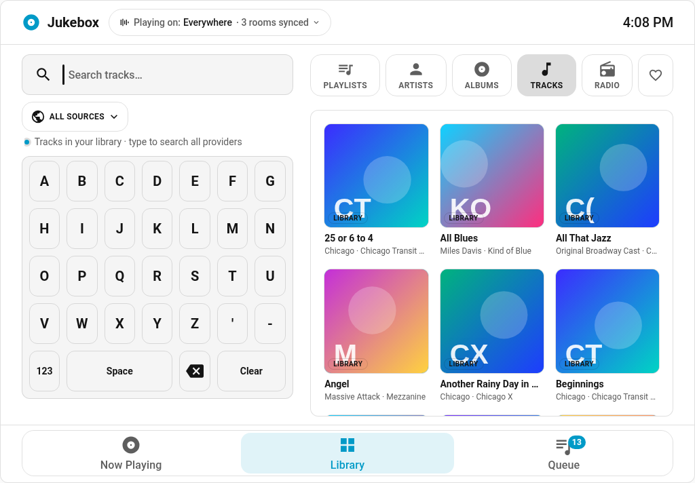 | 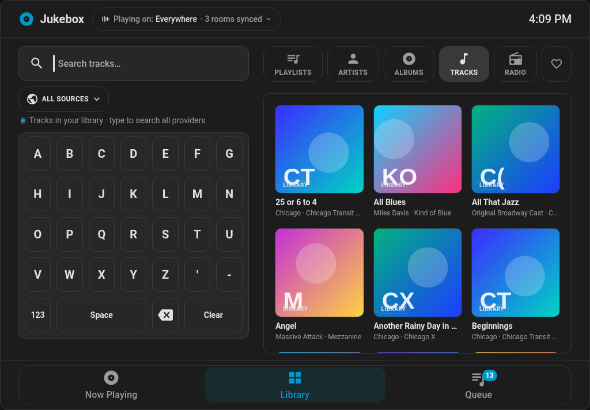 |

| Library, typing, light theme | Library, typing, dark theme |
|---|---|
| 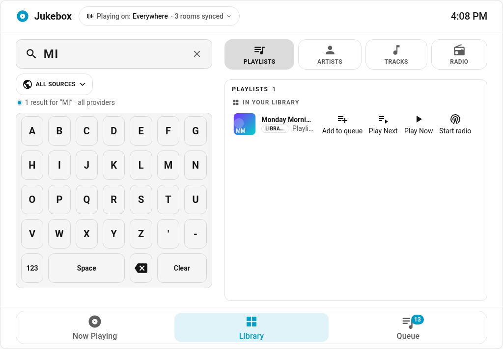 | 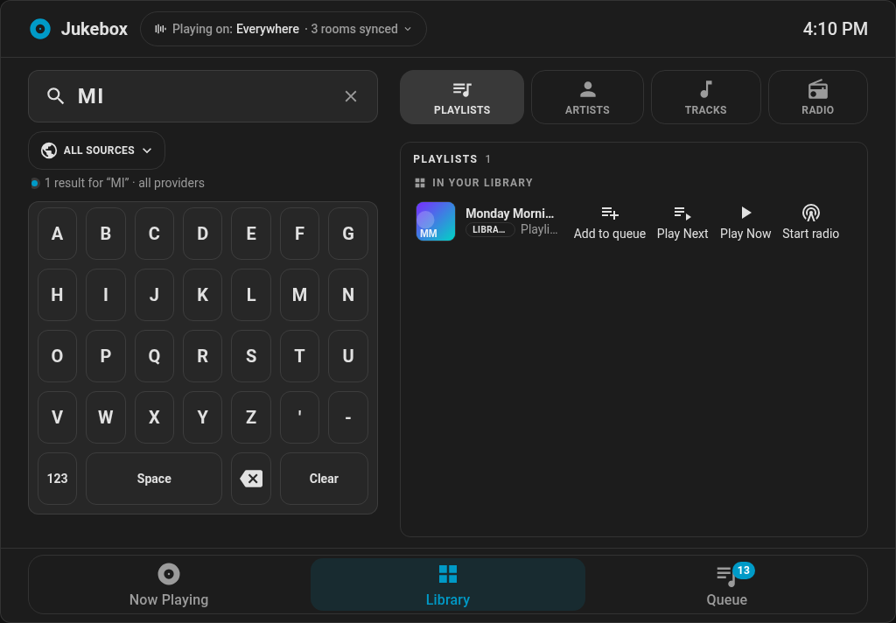 |

Before 0.8.0 (old look):

| All sources open, two services on | Typing, Spotify only (820x1180) |
|---|---|
| 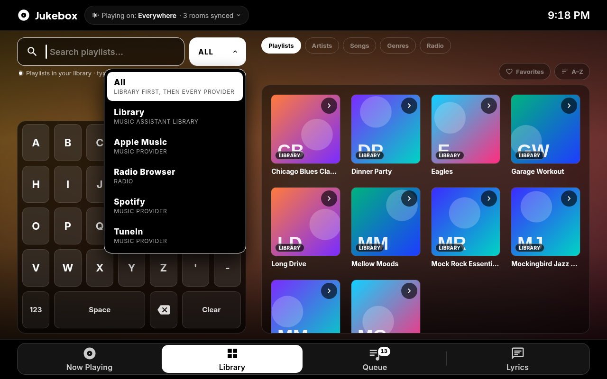 | 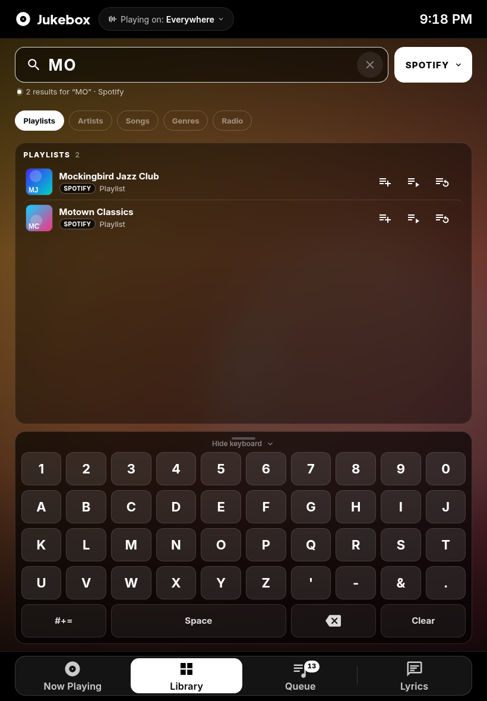 |

| Now Playing, light theme | Now Playing, dark theme |
|---|---|
| 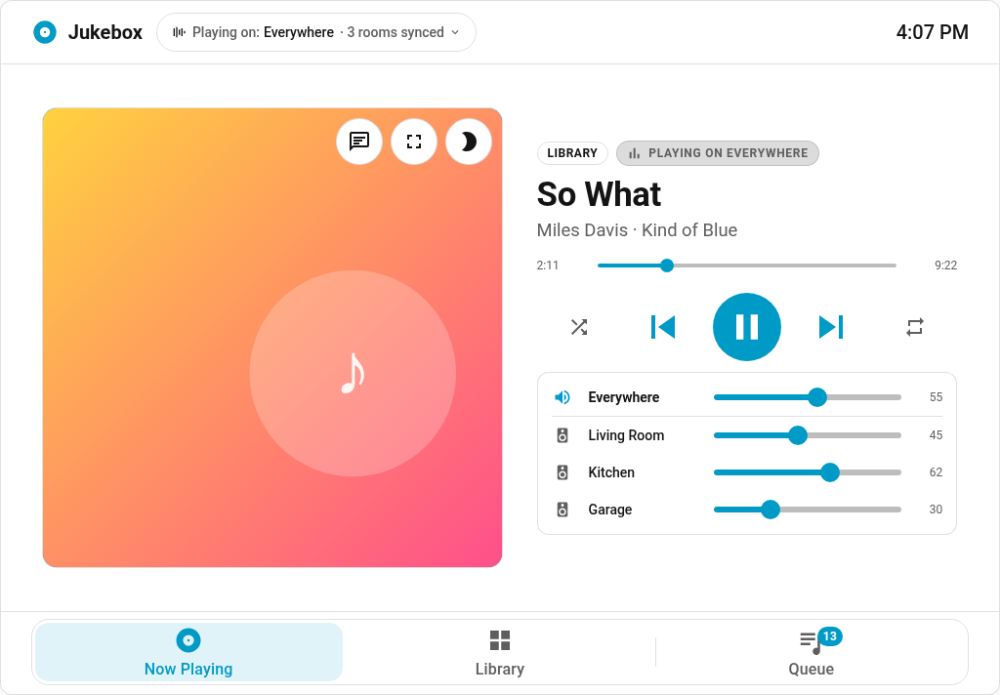 | 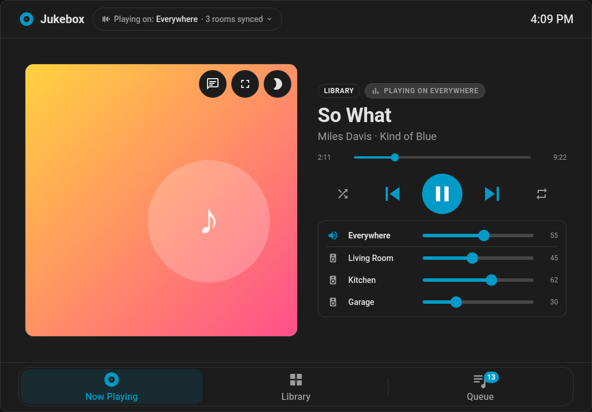 |

| Queue, light theme | Queue, dark theme |
|---|---|
| 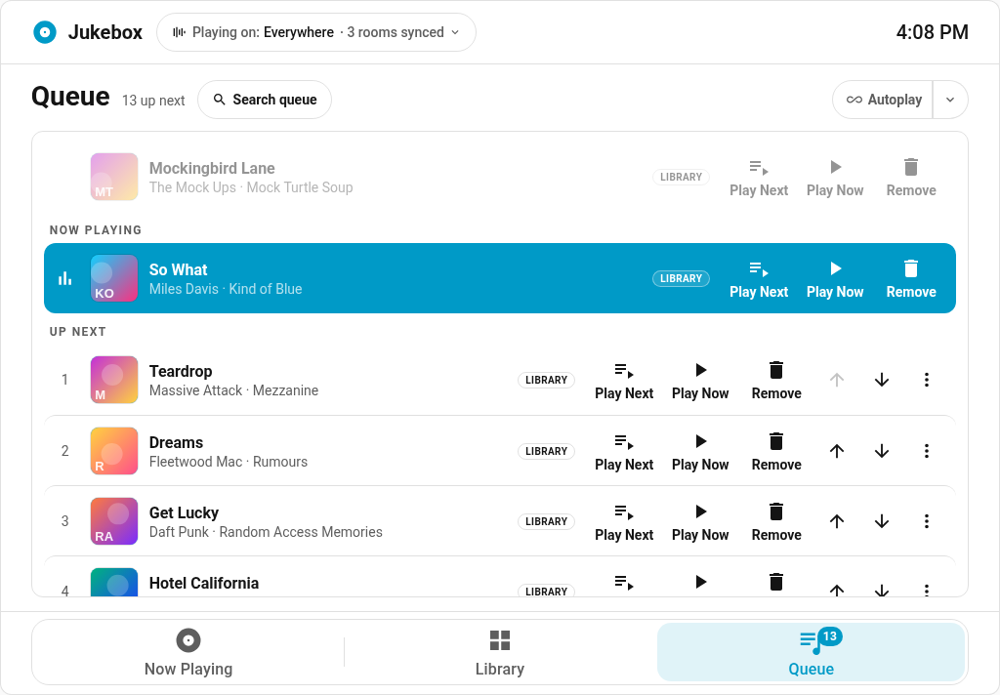 | 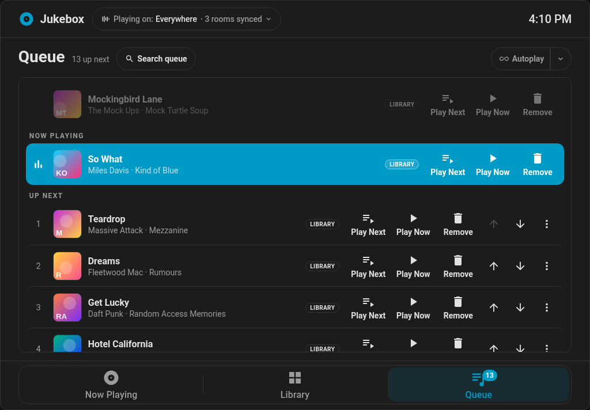 |

| Screensaver, light theme | Screensaver, dark theme |
|---|---|
| 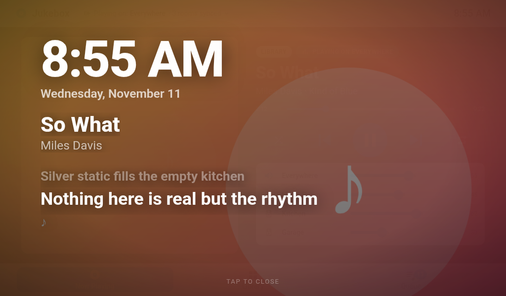 | 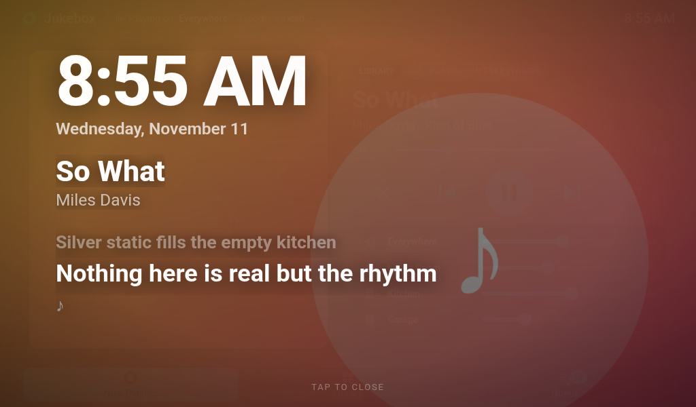 |

The Screensaver is the same in both themes: black, with white text. Only its font comes from the theme. Its pictures are from 0.8.0.

## Requirements

- **Home Assistant 2026.10.0** or newer.
- **[Music Assistant](https://music-assistant.io)** 2.10 or newer, and the official **Music Assistant** integration (`music_assistant`) set up in Home Assistant. Jukebox Kiosk uses that integration's connection, so it has no server URL or token of its own.
- **A Music Assistant player** to play to. Group players such as `media_player.everywhere` work too.
- mass_queue is **not** used. The card no longer knows it; you can uninstall it.

> **Music licensing and lyrics.** Jukebox Kiosk plays whatever your Music Assistant providers give it; it ships no music and no lyrics. Personal streaming subscriptions are usually for private listening only, so a public or commercial venue (a bar, shop, gym or event) needs music services and performance licenses that cover public playback. Lyrics are fetched live through Music Assistant's metadata providers when you open them; they are never bundled, and the card keeps lyric text in memory only.

## Install

### HACS (custom repository)

1. HACS → ⋮ → **Custom repositories** → `https://github.com/randybell/ha-jukebox-kiosk`, category **Integration**.
2. Install **Jukebox Kiosk**, then restart Home Assistant.
3. **Settings → Devices & services → Add integration → Jukebox Kiosk**, then choose your Music Assistant entry.
4. Add `type: custom:jukebox-card` to a dashboard (see [Configuration](#configuration)).

### Manual

Copy `custom_components/jukebox_kiosk/` (from the repository or the `jukebox_kiosk.zip` release asset) into `/config/custom_components/`, restart, then follow steps 3–4.

### Coming from the old Jukebox Card plugin (0.5.x)

The integration finds dashboard resources that still point at `/hacsfiles/ha-jukebox-kiosk-card/` (or `/local/community/ha-jukebox-kiosk-card/`, where Home Assistant 2026.11's Marketplace serves plugins) and removes them, so the card doesn't load twice. It then raises a Repairs issue that asks you to remove the old **Jukebox Card** plugin in HACS or the Marketplace. The issue stays, also across restarts, until the old plugin files are gone. YAML-mode resources can't be edited automatically; the Repairs issue lists the line to delete. Card configs keep working as they are. `mass_queue_entry_id` is ignored unless you set `backend: mass_queue`.

## Backends

The card picks its backend by itself; you don't set anything. The resolved backend is shown on the element as `data-backend`. There is no option for it (since 0.7.9); an old `backend:` line in YAML is ignored.

| Backend | Uses | Notes |
|---|---|---|
| picked automatically | `kiosk` if `jukebox_kiosk` is loaded, otherwise `native` | |
| `kiosk` | `jukebox_kiosk/*` WebSocket commands | Every feature. Controls the server doesn't allow for this user are hidden. |
| `native` | the official `music_assistant` services only | Search, Browse grid, transport, volume and playing music. No queue tab, track lists, lyrics or grouping. |

On the kiosk backend the card asks `jukebox_kiosk/capabilities` once per connection and hides what the server reports as unavailable: Move up and Move down when `queue_edit` is off, Undo, the remove-favourite heart (`unfavorite`), the Speakers panel's grouping (`speakers`) and lyrics (`lyrics`). Play Next, Play Now and Remove stay on the Queue rows; they are greyed when `queue_play` is off. The capabilities also carry the Music Assistant entry id (`ma_entry_id`), which is how the card finds Music Assistant for every user, admin or not.

## Permissions

Admins can do everything. In the integration's options (**Settings → Devices & services → Jukebox Kiosk → Configure**, form "Guest permissions") you choose:

- **Guest users**: these users get guest rights even if they are admins. This is handy for a kiosk login.
- **Treat every non-admin user as a guest** (default on): when this is off, non-admins get every class except `admin`.
- **What guests may do**: any of the classes below. `admin` can never be given to guests.

| Class | Allows | Guest default |
|---|---|---|
| `read` | queue, search, browse, lyrics | ✅ |
| `playback` | play and add music, jump in the queue | ✅ |
| `queue` | reorder, remove, undo | ✅ |
| `library` | favourite / unfavourite (every heart: Now Playing, Search and Library rows, playlists, the radio station sheet), playlists | ✅ |
| `speakers` | Music Assistant grouping: join / drop speakers (`players/cmd/set_members`), Move (`player_queues/transfer`), stop a group (`players/cmd/stop`) | — |
| `admin` | reserved; no command needs it since 0.7.3 (the `jukebox_kiosk/raw` diagnostic command was removed) | never for guests |

**Volume needs no class.** Volume and mute (the Now Playing sliders and the Speakers panel mixer, in fixed and dynamic mode) are sent as Home Assistant `media_player.volume_set` / `volume_mute` services, not through the integration, so a guest without `speakers` keeps the mixer. Without `speakers` the card hides grouping and the server refuses `set_members`, `transfer` and `stop`.

**Existing entries keep their saved choice.** The defaults apply when the integration is added (they are written into the entry's options) and when the options have no `guest_classes` key at all. An entry that already saved a list, for example one added from an earlier 0.6.0 draft with read, playback, queue and speakers, keeps exactly that list until you change it under **Configure**.

The server enforces these on every command. Hiding a control in the card is a convenience only; the card's own `grouping` option is still not a security boundary.

**Not per user.** Music Assistant passes the Home Assistant user only on search, library listings and `play_media`. Recently played, favourites and recommendations are shared by everyone on the Music Assistant server.

## Checked Music Assistant commands

No allowlisted command in `MA_COMMANDS` (`custom_components/jukebox_kiosk/const.py`) is still marked `TODO-VERIFY`. Each one is confirmed by the `music-assistant-client` signatures, by a live read, or by a read-only check against Music Assistant 2.10.9. `jukebox_kiosk/capabilities` therefore returns an empty `todo_verify` list. The last commands confirmed, all with read-only checks, were:

- **`music/genres/overview`** takes `item_id`, `provider_instance_id_or_domain` (default `library`) and `limit`, which is applied per row (default 25). It returns rows for Artists, Albums, Tracks and Playlists, whose ids are `genre_<type>`.
- **`music/podcasts/library_items`** and **`music/audiobooks/library_items`** take `favorite`, `search`, `limit` (500), `offset` (0), `order_by` (`sort_name`), `provider`, `genre` and `played_only`. They also take the keyword-only arguments `summary` (default true), `collapse_collections` and `reachable_via`. Send `summary: false` when you need `fully_played` and `resume_position_ms`. Both commands pass the Home Assistant user to Music Assistant, like the other library listings.
- **`music/item_by_uri`** is read-only only while `allow_update_metadata` is false, so the integration always sends `false`. It refuses any other value, and it refuses `allow_update_metadata: true` on every allowlisted command. For a track in your library, this command returns the library copy (provider `library`), even when you ask with a provider URI.

**Lyrics.** On the kiosk backend the card never sends a library track to `metadata/get_track_lyrics`, because Music Assistant would write to its library. It uses the provider copy in the queue (`current_item.media_item`) instead. If that isn't there, it looks up each provider mapping with `music/item_by_uri`, without `allow_update_metadata`. If the lookup returns the library copy, the card skips it. The card doesn't fetch from LRCLIB directly, so when it finds no provider copy it shows "No lyrics found".

## Configuration

> The card reference below was written for 0.5.x. Wherever it still names a `mass_queue.*` action, read the matching `jukebox_kiosk/*` command: that is what the card sends since 0.7.9. Track lists are paged by the server 100 at a time.

**A fresh card needs nothing typed.** Add the card, pick the player, and it plays: the card finds the Music Assistant entry through the integration (non-admins too), and the heart finds a way to favourite by itself.

Add the card to a dashboard. A single **panel** view is the layout it is built for. Entity ids in the example are labeled `example:`. Keys you leave out use the defaults in [Options](#options); those defaults are unchanged.

```yaml
# Example configuration. Entity ids below are examples; replace them with yours.
views:
  - title: Jukebox
    path: jukebox
    type: panel
    cards:
      - type: custom:jukebox-card
        entity: media_player.everywhere                # example: Music Assistant group player; every play_media goes here
        rooms:                                         # example
          - { name: Living Room, entity: media_player.living_room }
          - { name: Kitchen,     entity: media_player.kitchen }
          - { name: Garage,      entity: media_player.garage }
        screensaver_minutes: 10
        default_tab: now                               # now | browse | search (separate layout) | queue
        show_lyrics: true
        backdrop: plain                                # plain (default) | auto | full | light | static | off
```

The rest of this section is how each part of the card behaves.

### Themes

Since 0.8.0 the card follows the Home Assistant theme you use, the way Home Assistant's own cards do. 0.8.1 finished the job on light themes.

- **Colors, light and dark.** Text, backgrounds, lines and highlights come from the theme. Light and dark themes both work on every screen, also on themes with see-through cards. Buttons, chips, tags, the search boxes and the on-screen keyboard use Home Assistant's chip and input colors: a chip has an outline and no fill, a search box has Home Assistant's input fill, and the keyboard has no dark grey panel. A selected chip (the Library category, picked sources, the Queue choices) has Home Assistant's soft selected highlight, not a solid color. The tab you are on is marked the way Home Assistant marks the selected item in its own sidebar: a light tint of the theme's "sidebar selected" color (the main color by default) with that color for the label. The Play button, the playing row in the Queue, the heart and active shuffle and repeat use the theme's main color.
- **Corners, shadow and border.** The card takes them from the theme's card settings. The card draws no black shadows of its own (not on the cover, the Play button, the slider knob or the selected Library category); it uses Home Assistant's own card shadow only if your theme sets one. Pop-ups use the theme's dialog corners, shadow and maximum height, and they dim the screen behind them once, the way Home Assistant's own dialogs do. If your theme does not say how much, the card uses Home Assistant's own default (68% brightness); a theme that sets it, even to none, wins. Messages (toasts) look like Home Assistant's own.
- **Fonts.** The card uses the theme's fonts and its text sizes, weights and line spacing. With Home Assistant's default theme that is Roboto. The Inter and Plus Jakarta Sans fonts are no longer bundled, the `fonts/` folder is gone, and the card no longer downloads fonts. Titles and the clock look plainer than before. `font_base` no longer does anything, and you can remove it from your setup.
- **Now Playing title.** It can't be larger than the biggest size in Home Assistant's text scale (40 px with the default theme).
- **Now Playing background.** Since 0.8.1 there is none by default: `backdrop: plain` shows Now Playing as a plain theme card, like Library and Queue. Choose **Automatic**, **Full** or **Light** in the card editor (`backdrop: auto`, `full` or `light`) to get the blurred album art back. With those, the art, its dark shade and white text sit on Now Playing only. See [Backdrop and performance](#backdrop-and-performance).
- **No picture.** A cover with no picture, and a radio station with no logo, show a plain square in the theme's main color. The colored radio-tower picture is gone. With the `static` (Dark) background, Now Playing always has a flat fill in the theme's main color, `off` has the same fill in gray, and `full` and `light` have it only when there is no art. Text and icons on that fill use the theme's "text on primary" color, exactly like Home Assistant's media control card (no switching between black and white).
- **Panels on Now Playing.** The speakers panel and "up next" are solid theme cards with theme text, in every mode.
- **Screensaver and Stage.** They stay black with white text. Only their font comes from the theme.
- **Card-specific color settings.** There are none. Old `--jb-…` style overrides (from a theme or card-mod) no longer have any effect. Change the colors in your Home Assistant theme instead.

After updating, the card looks different: fonts and colors now come from your theme, and from 0.8.1 Now Playing has no album-art background unless you choose one.

### Backdrop and performance

By default (`backdrop: plain`, since 0.8.1) Now Playing has no album-art background: it is a plain card in your theme's colors, like Library and Queue, and the cover shows in its own square. To get the blurred album art back, set **Background** in the card editor to **Automatic**, **Full** or **Light**, or in YAML set `backdrop: auto`, `full` or `light`. The art, its dark shade and the color behind it are drawn on Now Playing only. The Library, Search and Queue screens use your theme's colors alone, also on themes with see-through cards.

The full look puts a 38 px live blur of the album art behind the Now Playing screen. That is cheap on a desktop GPU but expensive on low-end kiosk tablets, because the blurred layers have to be re-rastered whenever anything on top of them changes (a slider knob, a new track). The `backdrop` option picks the look:

| `backdrop` | Now Playing background |
|---|---|
| `plain` (default) | no art, no shade and no fill: your theme's card surface, like Library and Queue. The cheapest look |
| `auto` | album art: `light` if `navigator.hardwareConcurrency <= 4`, or `navigator.deviceMemory <= 2`, or `prefers-reduced-motion: reduce`; otherwise `full` |
| `full` | album art: live CSS `filter: blur(38px) saturate(1.15)` of the full-size art, with a dark shade over it |
| `light` | album art: the art drawn **once per track change** into a 64 px canvas (downscaled to 10 px, then smooth-upscaled and lightly blurred), stretched by the compositor; no CSS filter |
| `static` | no art; a flat fill in your theme's main color, with the theme's "text on primary" color for text and icons (**Dark** in the editor), like Home Assistant's media control card |
| `off` | no art; the same fill in gray (**Off** in the editor), like Home Assistant's media control card when it is off |

- The speakers panel and "up next" on Now Playing are solid theme cards in every mode, with no `backdrop-filter`.
- The resolved mode and the reason are on the element: `<jukebox-card data-backdrop="light" data-backdrop-why="hardwareConcurrency=4">`. Use this to check what a Fully Kiosk tablet picked (Fully's remote admin → "Get page source" or a remote DevTools session). With the default it reads `data-backdrop="plain"`.
- `light` needs no CORS: drawing a cross-origin image into a canvas is allowed as long as nothing reads the pixels back, and the card never does. If an image fails to load, the canvas stays hidden and your theme's main color shows.
- `light` redraws only when the art URL changes or the screen's aspect ratio changes, never on slider drags or key presses (test 15c).
- Colors: they come from your Home Assistant theme. The old `--jb-panel-filter`, `--jb-surface` and `--jb-panel-solid` overrides are gone (see [Themes](#themes)).
- The screensaver is not affected by `plain` or by themes. It shows the art (unblurred, so no filter cost) in `plain`, `full` and `light`, and plain black in `static` and `off`.

**Reduced motion.** With `prefers-reduced-motion: reduce` (Android: Settings → Accessibility → Remove animations), `auto` picks `light`, and the screensaver turns off its Ken Burns zoom and its continuous drift. To still protect the panel from burn-in, the clock block jumps to a new position every 60 s with no animation (`step-end`), cycling through 10 spots over 10 minutes.

**Measured** with `node test/perf.mjs 3` in headless Chrome at 1920x1080 with a 4x CPU throttle (CDP `Emulation.setCPUThrottlingRate`), means of 3 runs of about 6.4 s each. Frame times are in ms.

| Scenario | avg | p95 | max | frames >33 ms | long tasks | main-thread ms | raster/GPU ms |
|---|---|---|---|---|---|---|---|
| slider drag, `full` | 16.7 | 16.8 | 16.8 | 0% | 0 | 665 | 190 |
| slider drag, `light` | 16.7 | 16.7 | 16.8 | 0% | 0 | 692 | 175 |
| keyboard typing, `full` | 16.8 | 16.8 | 44.5 | 0.3% | 0 | 1701 | 1438 |
| keyboard typing, `light` | 16.8 | 16.7 | 33.3 | 0% | 0 | 1706 | 407 |

| `full` | `light` | `static` | `off` |
|---|---|---|---|
| 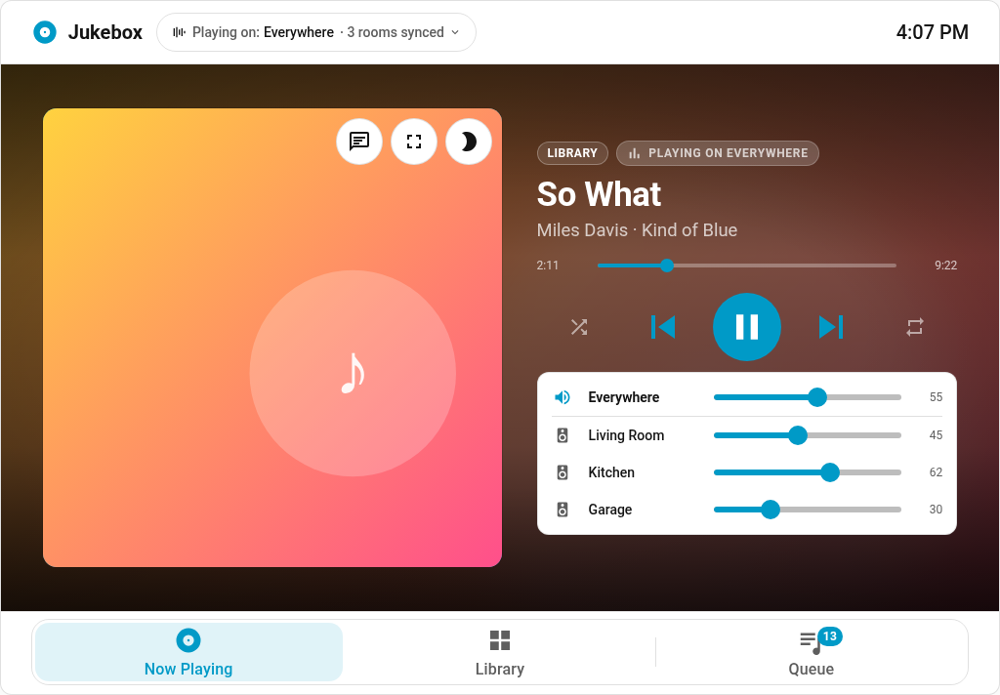 | 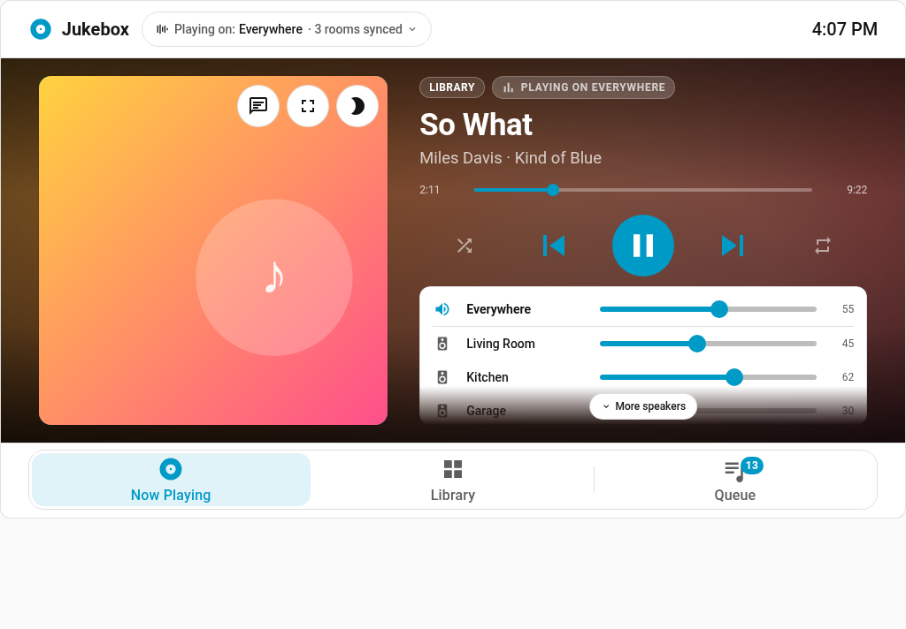 | 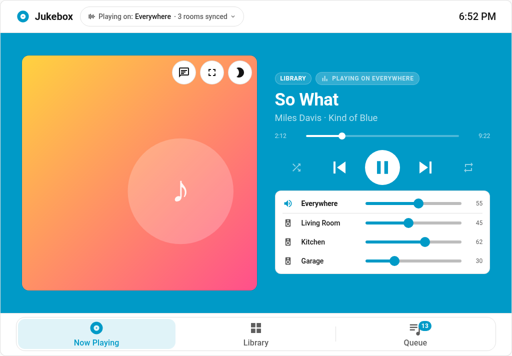 | 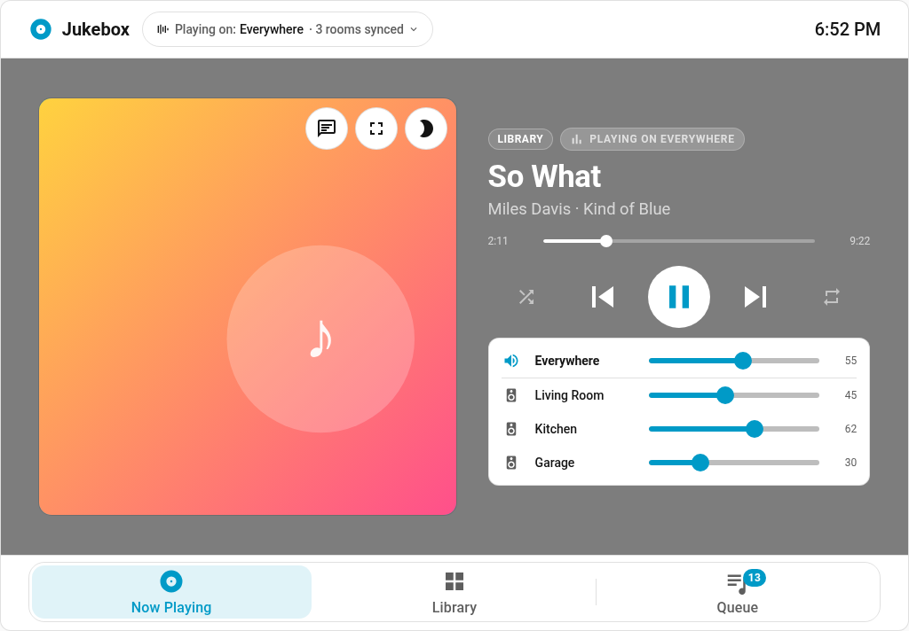 |

*Now Playing with a light theme and the Home Assistant default colors. `plain` (the default) is the picture in the Screenshots section above.*

| `static`, dark theme | `off`, dark theme |
|---|---|
| 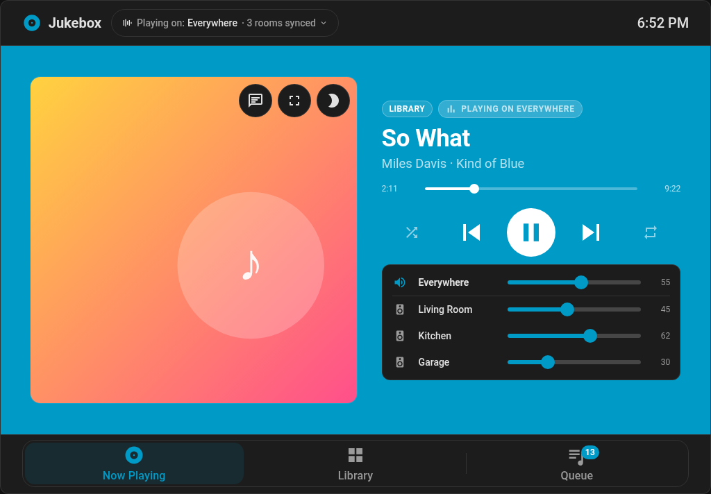 | 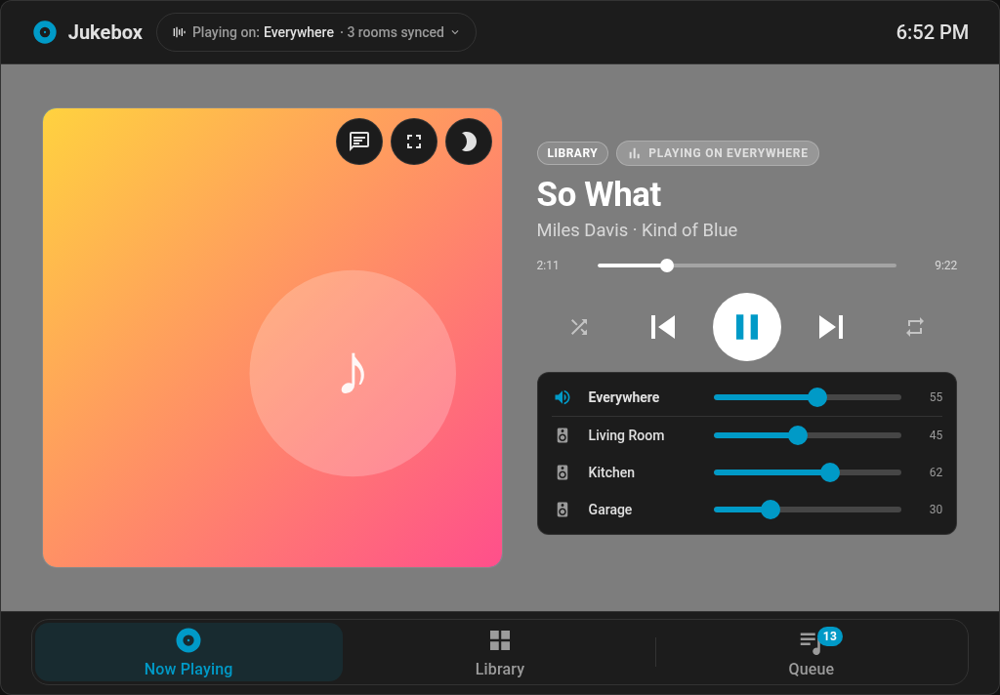 |

- Frame times are `requestAnimationFrame` deltas; long tasks come from a `PerformanceObserver('longtask')`; main-thread and raster/GPU time come from a CDP trace (`ThreadControllerImpl::RunTask` on the renderer main thread vs. compositor, raster and GPU threads).
- The main thread is not the bottleneck in either mode: no long tasks and a steady ~16.7 ms at 4x throttle. The blur cost is in raster/GPU work, which CPU throttling does not slow down, and on this box's fast CPU it still fits in a frame. The useful number is raster/GPU time, which is where a slow tablet's GPU drops frames. Typing (results re-rendering over a blurred backdrop) costs about 3.5x more raster/GPU time in `full` than in `light`. These numbers were measured before 0.8.0, when the art sat behind every screen; since 0.8.0 only Now Playing draws it.
- Re-check on the real tablet: open the dashboard with `backdrop: full`, then `light`, and compare how smooth the volume drag feels. If `auto` picked `full` on a weak tablet, set `backdrop: light` (or leave the default `plain`).

### Large screens (1920x1080)

The layout is designed around a 1280x800 tablet. On larger screens the whole card is zoomed (CSS `zoom`, set from a `ResizeObserver`) so the art, text and touch targets grow, rather than spreading out with empty space. At 1920x1080 the zoom is 1.35, which gives the 1280x800 layout's proportions at full resolution. Popover menus correct their position for the zoom (`localRect` in `src/shared.ts`; test 15k). Use `scale: 1` to turn this off, or a number to force a size.

### Row buttons (hidden by default)

Since 0.7.20 the buttons on list rows (Add to queue, Play Next, Play Now, Start radio, Remove, Move up, Move down, More and a station's Play) are **hidden by default**, on every row. To act on a track, tap it or press and hold it: both open the large pop-up with the choices. The **Show Action Icons** switch that 0.7.14 added to the card setup is gone from the editor. The option behind it, `show_action_icons`, still works for now. Its default is now `false`, and `true` in YAML turns the buttons back on:

```yaml
show_action_icons: true   # show the buttons on list rows; default false (since 0.7.20)
```

`show_action_icons` will be removed in a later release, and the buttons will stay hidden then. Because the switch is no longer in the editor, a card that should keep its buttons needs this line in its YAML. A card that already has `show_action_icons: false` looks the same as before.

With the buttons hidden, the title and subtitle use the room that frees up. This covers:

- Library lists: tracks, and the Library search results (tracks, artists, albums, playlists and radio stations). A station's **Play** button goes too; tap the station to open its panel and press **Play** there.
- The Queue and Queue search: Play Next, Play Now, Remove, Move up, Move down and the **⋯** button.
- The Albums rows on an artist page, and the column names above them.
- The track and episode rows on artist, album, playlist and podcast pages. Before 0.7.20 these always kept their buttons, even with `show_action_icons: false`. Their Remove button has no match in the pop-up, so Remove on those rows is available only with `show_action_icons: true`.

What stays: the heart and the LIBRARY tag, and the Genres list arrow in the older separate-tabs Library (if you use it). Tapping a track, or pressing and holding any row, opens the same large pop-up. The setting does not change what the buttons do, only whether they are shown. A value that is not `true` or `false` makes the card show an error.

### Now Playing

- **Art.** The card never loads the player's absolute `entity_picture` (`http://<ma-host>:8095/imageproxy?…` is mixed content on an https dashboard and unreachable off the LAN). It uses, in order: `entity_picture_local` (HA's relative `/api/media_player_proxy/…` URL), a relative `entity_picture`, the current mass_queue item's https `media_image`, then the placeholder. The same URL feeds Now Playing, both backdrops (`full` and `light`) and the screensaver. Radio streams with no art get a radio-tower image. Item images are used only when they are https, `data:image` or relative.
- **Display.** By default (`backdrop: plain`, since 0.8.1) Now Playing is a plain card in your theme's colors, like Library and Queue, and the cover shows in its own square. With the `auto`, `full` or `light` background the album art is blurred behind the screen, with a dark shade over it so the text stays easy to read; when nothing is playing, or there is no art, the screen then fills with your theme's main color with the theme's "text on primary" color on it, the way Home Assistant's media control card does. `static` and `off` always do. The tab shows the art, title, artist · album, a provider badge from the URI scheme and "Playing on Everywhere".
- **Seek bar.** Tap or drag it to send `media_player.media_seek {seek_position}`. The time label follows the drag.
- **Transport.** All transport calls target `entity` only:

  | Button | Call |
  |---|---|
  | Previous | `media_previous_track` |
  | Play / pause | `media_play` or `media_pause`, chosen from the state |
  | Next | `media_next_track` |
  | Shuffle queue | `shuffle_set {shuffle}` on the player the card is playing on (its Music Assistant queue) |
  | Repeat queue | `repeat_set {repeat}` on the same player, toggling off ↔ all; "all" repeats the whole queue. Repeat one is never offered or sent |

  Shuffle and repeat are queue settings: they always go to the active target (the group or player the card is playing on, e.g. Everywhere), never to individual member speakers, and there is no per-track or per-row shuffle or repeat. If the player ever reports repeat "one" (set somewhere else), the card shows it as repeat queue and, with `coerce_repeat_one` on (the default), sends a single `repeat_set {repeat: all}` to that player: once per detection, about 1.5 s after it is seen, at most once a minute, and only for a user with Playback permission. A message is never shown for this.
  Active shuffle and repeat use your theme's main color with a dot under them (on a solid main-color screen they use the theme's light text color); inactive ones are dimmer. The UI updates optimistically and reconciles when HA reports the new state.
- **Heart.** The heart adds the playing track to Music Assistant's favourites through the integration (`jukebox_kiosk/favorite_current`, needs the `library` class), or, on the native backend, presses the player's own Music Assistant "Favorite current song" button, found on the player's device. A filled heart removes it with `jukebox_kiosk/unfavorite_current`. When the card has no way to favourite, the heart is hidden. There is no option for it (since 0.7.9); an old `favorite_entity:` line in YAML is ignored.
- **Up next strip.** It shows the next queue item and "+ N more". Tapping it opens the Queue tab.
- **Volume:**
  - **Everywhere** sends `volume_set` to the group player.
  - **Each room** sends `volume_set {volume_level}` to **that room's entity only**.
  - Slide sideways to change the volume: the slider waits for a short sideways movement before the number follows your finger. A tap, a stray touch or scrolling up and down does not change it. This applies to Now Playing and the Speakers panel; the seek bar is unchanged.
  - While you drag, the card sends at most one call every 200 ms, and always sends the final value on release.
  - Tapping a speaker icon sends `volume_mute {is_volume_muted}` to that entity.
  - The card never joins or unjoins players.
- **Layouts.** In landscape the art is on the left; in portrait it sits on top, with rooms in a three-column grid on tablets. Phone layout applies at ≤520 px. Since 0.7.12 the top bar, the tab bar and the Library layout follow the card's own width rather than the browser window's, so a narrow card in a wide window (such as the card editor preview) is laid out as a narrow card.

### Queue

- **Reading.** The queue comes from `jukebox_kiosk/queue_items {entity_id, limit_before: 1, limit_after: queue_limit (1–1000)}`, and the card subscribes to changes (`jukebox_kiosk/subscribe_queue`).
- **Layout.** The previous track is dimmed. "Now playing" is the highlighted row, filled with your theme's main color, then a numbered "Up next" list. "+ N more in Music Assistant" appears when the queue is longer than the list.
- **Tapping a row.** Since 0.7.13, tapping a track opens the same large pop-up as pressing and holding it (see below). Before that a tap did nothing. A radio station in the queue is the exception: tapping it still does nothing. The row's own icons work as before, but since 0.7.20 they are hidden unless `show_action_icons` is `true`.
- **Row actions.** Since 0.7.20 the row buttons below are hidden unless `show_action_icons` is `true` (see [Row buttons](#row-buttons-hidden-by-default)). When shown, every track row has three buttons with an icon and a label, in this order: **Play Next**, **Play Now**, **Remove**. On a wide card they sit beside the title. Move up and Move down stay as the ↑ and ↓ arrows beside them (`move_queue_item_up` and `move_queue_item_down`). On a phone (the card is 520 px wide or less) Play Next, Play Now and Remove sit on their own row under the title, the arrows are hidden, and **⋯** opens an action sheet with Play Now, Play Next, Move up, Move down and Remove. Tap or press and hold a track row to open the same large pop-up as everywhere else. Since 0.7.12 it always lists **Play Now**, **Play Next**, **Move up**, **Move down** and **Remove**, in that order, then **More Info** (see the press-and-hold pop-up under Library), then **Cancel**. A choice that can't be used for that track stays in its place, greyed, and does nothing: for example Play Next and Move up on the track that is already next, Move down on the last track, and Play Next, Move up, Move down and Remove on the track playing now. Guests get the same list, with Play Next greyed on the track that is already next. In the pop-up, Remove works on the track that is next whenever that row's own Remove button works. A radio station in the queue has no More Info. The ⋯ button still opens its existing menu. With the buttons hidden (the default since 0.7.20) the row's Play Next, Play Now, Remove, Move up, Move down and ⋯ buttons are not shown; the pop-up still has all of those choices.

| Queue press-and-hold options, light theme | Queue press-and-hold options, dark theme |
|---|---|
| 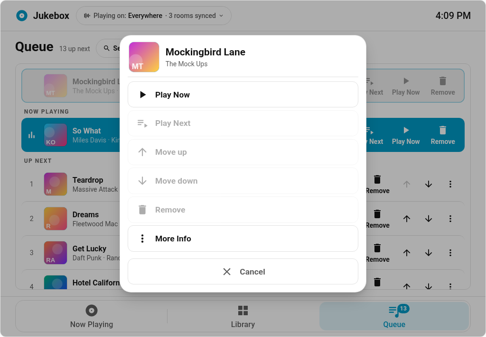 | 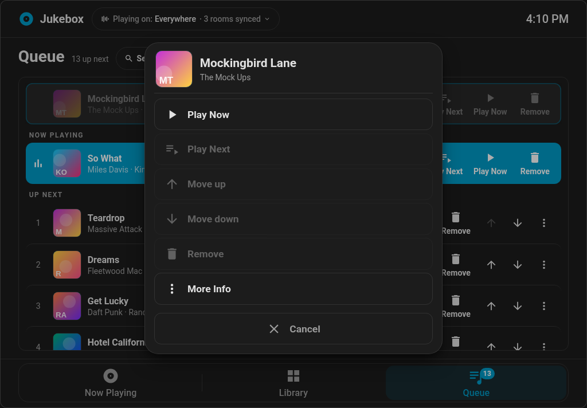 |

- **Search queue.** **Search queue** in the header opens a box and an on-screen keyboard that stays open. The list shows tracks whose title, artist or album contains what you type. Press and hold a track in the results (since 0.7.12), or tap it (since 0.7.13), to open the same pop-up as a normal Queue row, with the same choices and the same greyed-out rules. With a physical keyboard, typing goes into the search (since 0.7.13): letters, digits and punctuation are typed and Backspace deletes, so keys such as e, c, d, a and m no longer set off Home Assistant's own shortcuts (its search bar, Assist and so on). This applies only while Queue search is open on the Queue tab, and Esc is left to the card. **Done** closes the search and clears it.
- **Header.** The Queue tab badge shows how many items are left, and the header says how many are up next.
- **Play Now, Play Next and Remove** go through `jukebox_kiosk/ma` with the MA queue id. Someone who may not change the queue (see `grouping`, or `queue_play` off) still sees the three labels; they are greyed and do nothing.
  - **Play Now** asks first, "Play this now? The current track will stop.", then sends `player_queues/play_index {queue_id, index: queue_item_id}`. It only moves playback to that item: the queue keeps its items and order, and nothing is replaced, cleared or moved. It is greyed on the track that is playing.
  - **Play Next** sends `player_queues/move_item {queue_id, queue_item_id, pos_shift: (current + 1) − index}`, no dialog. It is greyed on the row that is already next, on the track playing now, and on tracks that have already played. If MA has already buffered the next track it ignores the move and the card shows MA's order again.
  - **Move up / Move down**: no dialog.
  - **Remove** sends `player_queues/delete_item {queue_id, item_id_or_index: queue_item_id}`, no dialog, and shows "Removed <title>. Undo" for 5 s. **Undo** re-adds the track's URI (`player_queues/play_media {queue_id, media: uri, option: add}`), finds the new row (`player_queues/items`) and moves it back (`move_item`). If it can only be re-added at the end, or not at all, the toast says so. Remove is greyed on the track playing now, on tracks already played, and on the track Music Assistant is already loading.
  - An action that cannot be used stays on the row, greyed. It is not hidden.
  - The track Music Assistant is already loading (the one after the playing track, near its end) can't be moved or removed: Play Next and Remove are greyed and the Move buttons are off. If MA refuses a move anyway the toast says "That track is already loading, so it can't move right now."; a refused or ignored Remove says "That track is already loading, so it can't be removed right now." The queue reloads either way.

### Speakers (0.5.0)

- **Header status** ("Everywhere · 3 rooms synced", or "N speakers") opens the Speakers panel. Since 0.7.12 the number of speakers in the header matches the Speakers panel, so a four-speaker group shows "Everywhere · 4 speakers" (it used to show "1 speaker" when Home Assistant listed only the speaker that leads the group). The panel opens on the right side of the card, between the header and the tab bar (so it fits the measured height below the HA toolbar), scrolls when it is taller than that, and closes on a tab tap or the **Close** button.
- **Fixed mode (default).** The panel is a mixer: one volume slider per room, nothing else. Every call goes to `entity`, exactly as in 0.4.
- **Dynamic mode.** "Play on" chips choose the target (remembered per device); joining, dropping and moving use Music Assistant only: `jukebox_kiosk/ma` with `players/cmd/set_members` and `player_queues/transfer` (never `media_player.join` / `unjoin`). Players are read with `players/all`. A static MA sync group is shown as fixed (no join/drop). Each room shows what it is playing. Presets (one per dynamic group, from Music Assistant's own default members) regroup in one tap. Changes are optimistic and time out. Every grouping message (joined, left, Regrouping…, errors, Undo) appears in one small status chip at the top right, under the header clock; it never covers the rest of the card, hides itself after about 4 s, and a new message replaces the old one. **Undo** in the chip works while it shows. Errors use the same chip in an inverted (white) style and stay a little longer. Since 0.6.4 drops happen on tap, with no centred dialog; a question that does need an answer (taking a speaker from another group, or the last room) is asked in the chip with one action button and ✕, and ignoring it does nothing. `confirm_drop: true` brings back the centred dialogs. Any room can be dropped and re-added, including the one that leads the group: the card asks MA to remove it from the group (`players/cmd/set_members` on the group, never an ungroup of the speaker), MA re-forms the group on the other rooms after about 6 s of silence and the queue plays on; the panel says "Regrouping…" until it does. `leader_drop: block` keeps the old behaviour (hand off with Move). The last room in a group can't be dropped (MA would stop and dissolve the group): tapping it shows "<Room> is the last speaker in <Group> · Pause" in the chip; Pause keeps the room and the queue, and "<Group> paused · Undo" resumes. While the group is idle, Join is shown greyed with a hint to start playback first. For dynamic MA groups the panel also offers MA's own default line-up as a "<Group> default" preset. Moving music to another target has a silence of about 5 s on the new target.
- **Permissions are a UI lock, not security.** `grouping` / `grouping_users` / `guest_access` only hide or disable controls in this card. Anyone with dashboard access can still call the same services from elsewhere in Home Assistant. Use HA users and dashboards to restrict access.
- **Editor:** a Speakers section. **Speakers panel** offers "Volume only: always play on the chosen player" or "Choose speakers: pick, group and drop speakers from the card". Only Choose speakers shows the rest: targets, who may change speakers, extra people, everyone else, **Removing the main speaker from a group** ("Allow: the music keeps playing on the other speakers after a short pause" / "Don't allow: use Move to hand the music to another speaker first") and the ask-before-dropping switch. Presets come from Music Assistant's group defaults; there is nothing to set.

| Speakers panel with room volumes, light theme | Speakers panel with room volumes, dark theme |
|---|---|
| 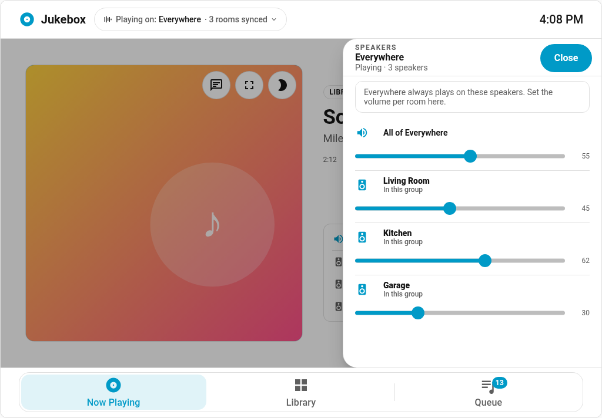 | 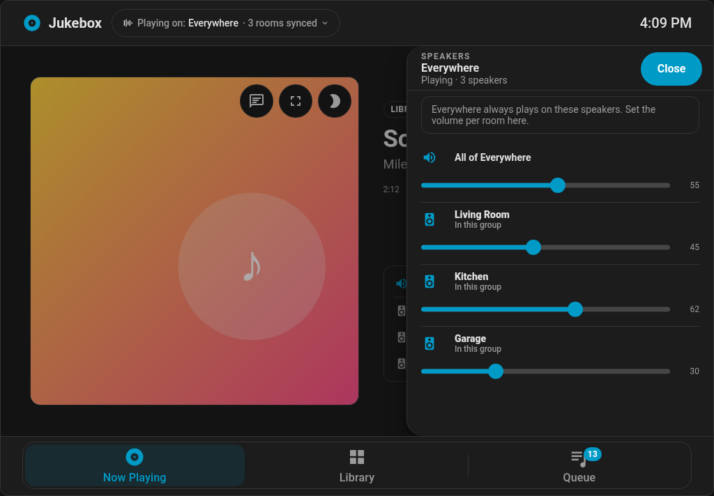 |

### Library (search and browse in one tab)

- **One tab.** Since 0.7.2 the **Library** tab (`library_label`) is where you browse and search; there is no Search tab and no tile home by default (`library_layout: combined`).
- **Search box, with All sources below it.** The box uses the on-screen keyboard and searches on every keystroke (see [How search behaves](#how-search-behaves)). **All sources** sits below the box. Tap it to open a row under the box: **All** (the usual choice), **Library**, then the music services set up in Music Assistant, using the names you gave them. A service that is not available is left out. The row wraps when there are many, and on a phone it scrolls sideways. It does not cover the screen. Tap **All sources** again to close the row.
  - **Picking more than one.** Tapping a service while All is on selects just that service. Tapping more adds them. Tapping a selected one turns it off. When none is left, it goes back to **All**. Tapping **All** clears the others. While any are picked, the button turns white. On a larger screen the button shows the names (shortened if they do not fit); on a phone it says **All** or how many are on. The open row still shows each name in full, and the line under the box is hidden. With `library_keyboard: tap`, and on the separate Search tab, a larger screen shows the names on the button (for example "Apple Music + TuneIn"), shortened if they do not fit, a phone says **All** or how many are on, and the line under the box names the selection.
  - `search_sources: false` hides the button and the row.
- **Category buttons.** Big buttons with an icon and a name: Playlists (where the tab opens), Artists, Tracks, Radio. The one you are in has the soft selected highlight. Albums, Podcasts and Audiobooks appear only if you list them in `library_categories`, which also sets the order. There is no Genres button here (since 0.7.9), even if `genre` is in `library_categories`. With the keyboard always open, a phone shows the icons only.
- **Favorites.** On the library list (nothing typed, and All or Library chosen) a small heart sits at the end of the category row. It shows favorites only. There is no sort button (since 0.7.9): lists keep their usual order, A–Z, and radio stations most played first. The heart is hidden while you are typing, while a music service is chosen, while Search in an artist or album is on, or on a detail page. Favorites is no longer a chip in a bar above the list.
- **Empty box, All or Library alone:** the library list of the selected category. Genres lists `music/genres/library_items` (the older separate-tabs Library layout only; there is no Genres button on the combined tab). Since 0.7.12 there is no genre page, so tapping a genre in that old-layout list opens nothing.
- **Typed text:** results for the selected category and source only. With **All**, library matches come first ("In your library"), then provider results ("From your providers"); **Library** shows library matches only; providers send one `music/search` with all of them in `providers`; **Library** plus providers shows library matches first, then those providers.
- **Provider with an empty box:** one provider shows its folders (`music/browse <provider>://`, admins) or an inline hint "Type to search <provider>"; several providers show the inline hint ("Type to search Apple Music + TuneIn") — never a popup.
- **Filters.** "Search in <artist / album>" adds the artist/album chip and **Clear filters** next to the box. Clear filters also empties the box and puts the source back to All. If the All sources row is open, it stays open. The screensaver, with `idle_clear_filters` on (the default), clears the same things and also closes that row.
- **Old configs.** `default_tab: search`, a saved Search tab or any "search" shortcut opens the Library tab with the keyboard up. `library_home: true` from 0.7.1 is ignored (no tiles). `library_layout: separate` brings back the 0.7.1 Library + Search tabs (tile home with `library_home: true`, the 0.7.1 chip row). On that Search tab the source buttons stay in a row under the box.

| Library artists, light theme | Library artists, dark theme |
|---|---|
| 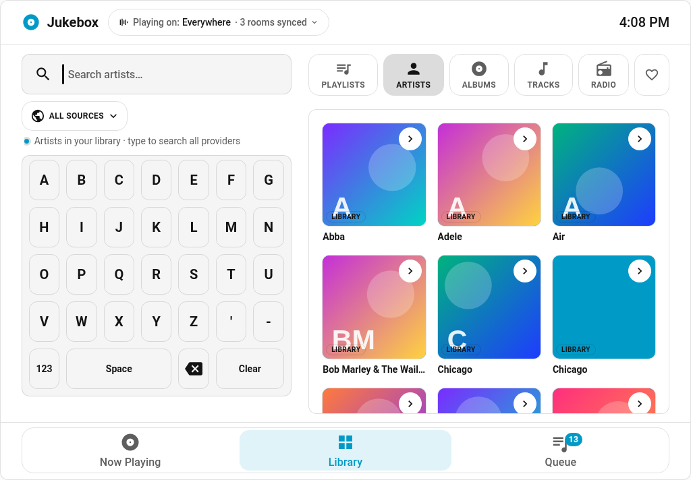 | 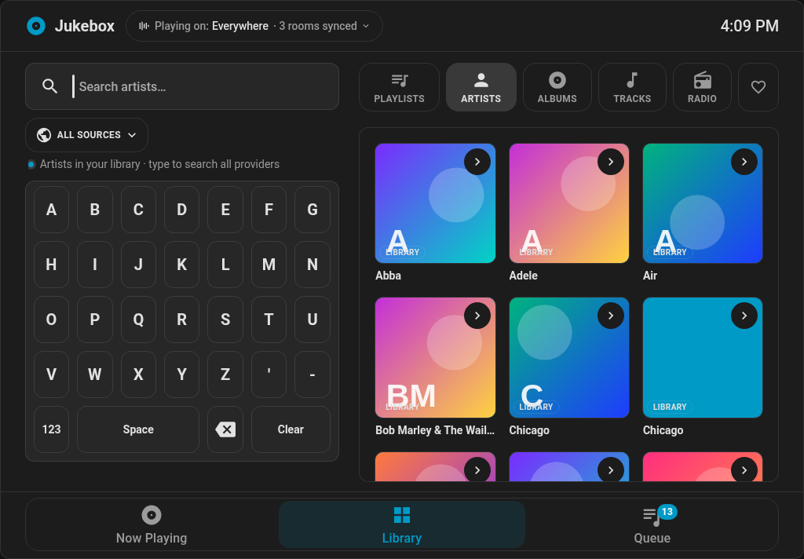 |

Before 0.8.0 (old look), Library track rows:

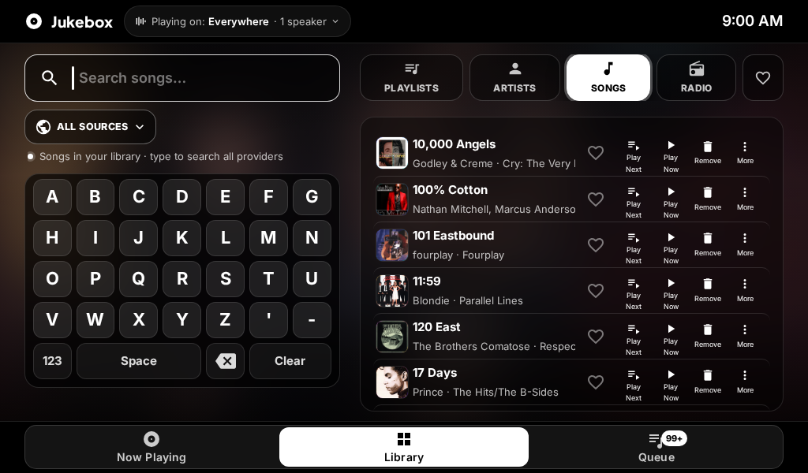

#### Library list details (all layouts)
- **Categories.** On the combined tab the buttons are the ones above. On the separate Library tab the chips are Playlists, Albums, Artists, Tracks, Radio, Podcasts and Audiobooks.
  - Each call is `music_assistant.get_library {config_entry_id, media_type, favorite?, limit, offset, order_by}` with `return_response`.
  - At start the card makes one `limit: 1` call per category and **hides the categories that are empty**, such as Radio, Podcasts and Audiobooks when the library has none.
- **Favorites and sort.** On the combined tab there is only the heart at the end of the category row, and no sort button (since 0.7.9). On the separate Library tab they stay in the bar above the list: a **Favorites** toggle, and a sort chip. The cycle is A–Z (`name`), then Recently added (`timestamp_added_desc`), then Recently played (`last_played_desc`). Radio starts on Popular (`play_count_desc`; `get_library` has no popularity order, so this is your own play count), then A–Z, Recently added and Recently played. Genres use A–Z and Recently added, and have no Favorites control.
- **Layout: rows or tiles.** Since 0.7.20 the option `library_view` chooses how the top level of every Library button is drawn: `rows` (the default) or `tiles`. In the editor it is **Library lists (every Library button: rows or tiles)**, with the choices **Rows: a list with small covers** and **Tiles: a grid of big covers**.
  - **Rows** are list rows: a small square cover, the title, the line under it (such as the artist or the owner), the source badge, the heart, and an arrow where a tap opens a page. Rows have no row buttons. A tap or a press and hold does the same as on the matching tile.
  - **Tiles** are big covers with provider badges in a grid. `library_columns` sets how many columns: a whole number from 2 to 6, default 3. It counts only with tiles, and the editor shows **Tile columns (2 to 6)** only when Tiles is chosen. Before 0.7.20 the grid fitted as many columns as the width allowed. A number outside the range is brought to the nearest end (1 becomes 2, 9 becomes 6), a number with decimals is rounded (4.4 becomes 4), a number written in quotes such as "4" is accepted, and anything else, including an empty value, counts as 3. The editor does the same and drops a value that is not a number.
  - Because rows are the default, Playlists, Artists, Albums and Radio now show as lists unless you pick tiles. With tiles, Tracks and Genres also become tiles; they were always rows before. Artists are no longer round anywhere in the Library lists.
  - It applies to Playlists, Artists, Tracks and Radio (including Favorites, More stations and the online Radio Browser station lists), to Albums, Podcasts and Audiobooks when you list them in `library_categories`, and to Genres in the older separate-tabs Library. The folders in Radio Browser stay rows.
  - It does not change the pages you open (artist, album, playlist and podcast pages), search results, the Queue, the optional Library home screen, or the Discover rows, which keep their round artist tiles.
  - A `library_view` other than `rows` or `tiles` counts as `rows`. Neither option stops the card from loading, whatever is typed.

  ```yaml
  library_view: tiles     # rows (default) or tiles
  library_columns: 4      # 2 to 6, default 3; only with tiles
  ```

  Pages are cached per category, favorite and sort, and load more on scroll.
- **Tap never plays.** Artists, albums, playlists (and podcasts) open the detail view described under Search, with the same buttons and confirmations. On album, artist, playlist and podcast pages a tap or a press and hold on a track or episode opens the large pop-up (since 0.7.20; see below). Their rows have **Play Next**, **Play Now** and **Remove** buttons only with `show_action_icons: true`. On an artist page the Albums rows are different (since 0.7.10): small icon buttons for Add to queue, Play next, Play now and, where offered, Start radio, named once in a column header that stays in place while you scroll. There is no Remove or More on these rows. Since 0.7.20 the buttons and the column header are hidden unless `show_action_icons` is `true`. Since 0.7.13 the buttons work on a normal tap or click (in 0.7.10 to 0.7.12 they needed a press-and-hold of about half a second); Play now and Start radio still ask first. Press and hold the row itself (off its buttons) to open the pop-up for that album. Search result buttons work the same way, but their icons and short names appear on each result row rather than in a column header. **A tap on a track in the Tracks list opens the large pop-up** (since 0.7.13), the same one that pressing and holding the row opens, in both the combined and the older separate-tabs Library layout. The old small menu is gone for tracks, and the **More** button on a track row opens the pop-up too. A tap on a track also opens the pop-up in Search results and in the Queue, and on track tiles in Discover rows. Since 0.7.20 a tap or a press and hold on a track or podcast episode on an artist, album, playlist or podcast page opens it too. It lists Add to queue, Play next, Play now, Start radio and More Info, then Cancel, the same as in the Tracks list, and Play now and Start radio still ask first. A podcast episode has no Start radio. A radio station row on those pages is still only highlighted by a tap. A tap on a station opens the station panel with its details, a heart where allowed, Play and Close; Play asks "This will replace your queue" (Cancel / Play) when the queue has tracks. **Press and hold** (since 0.7.10) opens a large options panel with the item's art and name: Open (when the item has a page), Add to queue, Play next, Play now, Start radio, and Cancel. Since 0.7.12 Start radio is always listed on track, album, artist and playlist pop-ups; when that item can't start a radio it stays in its place, greyed, and does nothing. Podcast, episode and audiobook pop-ups have no Start radio. Tracks, podcast episodes and audiobooks also get **More Info**, just above Cancel (since 0.7.12). More Info changes the same pop-up to a details view; **Back** returns to the choices. It shows only what Music Assistant already sent with the item, and leaves out any line that is unknown. Tracks show Album, Year, Length, Source and Quality. Podcast episodes show Show, Episode (the episode number), Published (a date such as "Nov 1, 2026"), Length, Left, Source and Quality. Audiobooks show Author, Narrator, Publisher, Published, Length, Left, Source and Quality. Left is the time remaining, and only appears once you're partway through; it reads "Played" when the episode or book is finished. Episodes and audiobooks show no description. More Info is greyed and does nothing when no line other than Source has anything to show (a source on its own doesn't count). Album, artist, playlist, whole-podcast and station pop-ups have no More Info, and More Info is not a button on the rows. Stations get Open, Play now and Cancel. Since 0.7.12 every pop-up is only as tall as its buttons need and stays between the top bar and the bottom tab bar, with one shared button and text size, so all pop-ups look alike; if the choices would not fit, everything shrinks together. Cancel comes right after the last choice. Tap outside the panel or Cancel to close it.
- **Radio.** Browse > Radio lists `get_library {media_type: radio}`. Favorites appear first, followed by other library stations. If there are none, the card shows "No stations yet" with a **Search stations** button and a hint to search by name; it no longer fills the grid with a search for "radio". With `radio_favorites_only`, only favorites appear, and an empty list says "No favorite stations yet". Station names are trimmed (Radio Browser pads some with tabs), every station has a **Radio** badge, and a station with no logo or a dead logo gets a radio-tower image. A tap does not play the station: it opens the station panel with its details, a heart where allowed, Play and Close. Play asks "This will replace your queue" (Cancel / Play) when the queue has tracks, then sends `play_media {media_id: radiobrowser://radio/…, media_type: radio, enqueue: replace}` to `media_player.everywhere`, never with `radio_mode`.
- **Drill-down.** The › button on artist, album and playlist tiles (or the › arrow at the end of their rows), or Open in the menu, opens a detail page:
  - a back button, Play, Shuffle, Add to queue and Start radio (`radio_mode: true`, tracks / artists / albums only), and a track list. Tapping or pressing and holding a track opens the pop-up (since 0.7.20; before that a tap only highlighted the row). The rows have **Play Next**, **Play Now** and **Remove** buttons only with `show_action_icons: true`
  - tracks come from `jukebox_kiosk/item_tracks {uri, page, page_size: 100}`. Each row shows its duration, and the header shows the count and total time ("9 tracks · 43 min", with "+" while more pages may follow)
  - long lists are paged by the server: the next page loads when you scroll to the end or tap **Load more tracks**
  - artists also get an Albums row from `music_assistant.search`
  - without the integration (native backend), albums and artists fall back to a search, labelled "matched by search", and playlists show a note that the integration is needed
- **Search's Open action** jumps to the same detail page.
- **Target.** Every `play_media` goes to the configured player (example: `media_player.everywhere`). Room players are volume targets.

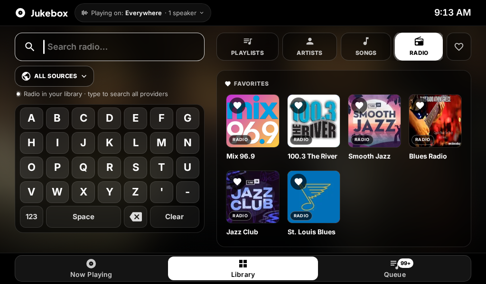

### Favourites (hearts)

*(0.7)* With the Jukebox Kiosk backend, a heart sits on Search and Library rows and tiles (tracks, albums, artists, playlists, radio), on playlist rows and in the header of album, artist and playlist pages, on Now Playing and on the radio station sheet. A filled heart means the item is a Music Assistant favourite; tapping it adds or removes it through the integration (`music/favorites/add_item` / `remove_item`). Every heart for the same item updates at once.

- Needs the `library` permission class. Without it (for example a guest you removed it from) the hearts are hidden, including the one on Now Playing.
- No confirmation when you remove a heart. The heart flips immediately; if Music Assistant refuses or the call fails it flips back and the top-right status chip shows the error (with ✕). Successful changes show a short "Added … to favorites" in the same chip. There are no popups in the middle of the screen.
- `hearts: false` hides the 0.7 row, tile and page hearts.

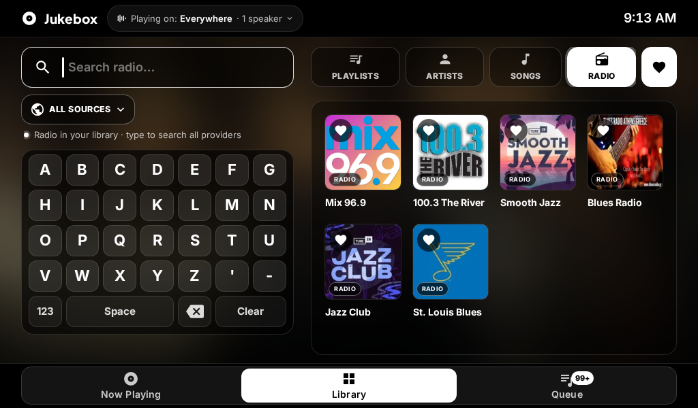

### Screensaver

- **Start.** After `screensaver_minutes` with no touches or keys, a full-screen overlay appears: the current art with a slow Ken Burns zoom, and a big clock, date and the current track, all drifting slowly (240 s loop) to avoid burn-in.
- **Reduced motion.** No zoom and no drift; the clock block jumps to a new spot every 60 s instead.
- **Wake.** A tap wakes it. The tap is swallowed, so it never presses whatever is underneath, and the overlay fades out over 350 ms.

### How search behaves

- **Searches on every keystroke, backspace included, from 1 character.** There is no debounce and no minimum length.
- **The call:**
  ```
  hass.callService('music_assistant', 'search', {config_entry_id, name, limit, media_type: [artist, album, track, playlist, radio, audiobook, podcast]}, undefined, false, true)
  ```
- **Newer results always win.** Every request gets a sequence number, and a reply that is older than the results on screen is dropped. Dropped replies are still cached.
- **No blank flash.** The old results stay on screen until the new ones arrive. A thin hairline under the query bar shows a search is loading.
- **Cache.** Up to 100 queries are kept for 5 minutes (LRU). Backspacing back to an earlier query shows its results instantly, without a new call.
- **Slow Music Assistant.** If a reply takes more than `slow_ms` (800 ms), the card keeps one call in flight and queues only the latest query. Keystrokes in between are merged into that one.
- **Results.** They are grouped as Artists, Albums, Tracks, Playlists, Radio, Audiobooks and Podcasts, with filter chips. **Empty groups and their chips are hidden**, so Radio (when no radio provider answers), Audiobooks and Podcasts don't show. Radio items get a **Radio** badge, a 'Live radio' subtitle, and no Start radio action. Each item has a provider badge taken from its URI scheme, because MA items have no provider field (`library://…` → LIBRARY, `apple_music://…` and `apple_music--XXXXXXXX://…` → APPLE MUSIC).
- **Every result is a list row**: art (round for artists) or an icon, title, subtitle (provider badge, type, artist / album; on phones the track length joins the subtitle). Titles truncate with an ellipsis; rows are at least 56 px tall.
- **Row actions.** Since 0.7.20 these buttons are hidden unless `show_action_icons` is `true`; tap or press and hold a row to open its pop-up instead. When shown, each result row (tracks, artists, albums, playlists, podcasts, audiobooks) has buttons with an icon and a short name, in this order:

  | Button | What it sends | Confirmation |
  |---|---|---|
  | Add to queue | `play_media` with `enqueue: add` (to the end of the queue) | none; it runs at once |
  | Play next | `play_media` with `enqueue: next` | none; it runs at once |
  | Play now | `play_media` with `enqueue: replace` | "Replace the current queue? This clears what's playing for everyone." Cancel / Replace |
  | Start radio | `play_media` with `enqueue: replace, radio_mode: true` | "Start radio from “…”? This replaces the current queue for everyone." Cancel / Start radio |

  Since 0.7.13 these buttons work on a normal tap or click, like the buttons in every other list (in 0.7.10 to 0.7.12 they needed a press-and-hold of about half a second). Start radio is shown for tracks, artists, albums and playlists. It is hidden for radio stations, podcasts, episodes and audiobooks. A radio station row has a single **Play** button instead. It still works only on a press-and-hold of about half a second, so a quick tap never plays a station, and it asks "This will replace your queue" (Cancel / Play) before the station starts. There is no Remove and no More button on search results. While the buttons are hidden (the default since 0.7.20), the buttons on every result row, including a station's Play button, are not shown; tapping or pressing and holding the row still opens its pop-up or panel. Add to queue and Play next send at once. Play now and Start radio send nothing until you confirm; Cancel, Esc or tapping outside sends nothing.
- **Tapping a row never plays.** An artist, album, playlist (or podcast) opens its detail view in place. Since 0.7.13 a tap on a track opens the large options panel described under Library, the same one that pressing and holding the row opens (before that the row was only highlighted). A station row opens the station panel, and an episode or audiobook row is only highlighted. Press and hold a row (off its buttons) to open the panel for any kind of result. The row's icon buttons work on a normal tap (since 0.7.13), except a station's Play button, which still needs a press-and-hold. The artist page's Albums rows have normal-tap buttons too.
- **Detail views** (from Search, Browse or Enter on the top result): Back, Play, Shuffle, Add to queue and, where the seed is supported, Start radio. Play and Shuffle replace the queue, so they ask first; Add to queue does not. Since 0.7.20 a tap or a press and hold on a track or podcast episode opens the large pop-up (Add to queue, Play next, Play now, Start radio for tracks, More Info, then Cancel). With `show_action_icons: true` those rows also have **Play Next**, **Play Now** and **Remove** buttons. An artist's Albums rows instead have icon buttons for Add to queue, Play next, Play now and Start radio (where offered) under one column header, with no Remove, shown only with `show_action_icons: true`; they work on a normal tap (since 0.7.13; press and hold in 0.7.10 to 0.7.12). Press and hold the row itself to open the pop-up for that album. A tap on an album row inside an artist opens that album.
  - **Play** sends `play_media … enqueue: replace`; if the player is shuffling it first sends `media_player.shuffle_set {shuffle: false}` (awaited) so the list plays in order.
  - **Shuffle** sends `media_player.shuffle_set {shuffle: true}` to the player, waits for it, then `play_media … enqueue: replace`. Music Assistant applies the queue's shuffle flag as it loads the new items, so the whole album / playlist / artist plays in random order using documented services only (no client-side reordering of URIs).
  - Track lists come from the integration. Without it (native backend), albums and artists fall back to a search, labelled "matched by search" with a note; playlists say that the integration is needed for their tracks (Play / Shuffle still work).
- **Service call:** `music_assistant.play_media {media_id: <uri>, media_type, enqueue[, radio_mode]}` with target `{entity_id: <entity>}`.
- **Recents.** After a play or opening a detail view, the query is saved to localStorage (`jukebox-card:recents:v1`, up to 8). Tap a chip to search it again; hold a chip 0.7 s to remove it.
- **Hardware keyboard:**

  | Key | Action |
  |---|---|
  | Letters, digits, punctuation | Type (shown uppercase) |
  | Backspace | Delete a character |
  | Esc | Close the confirmation or menu, then leave a detail view, otherwise clear the query |
  | Enter | Open the top result's detail (or highlight a track); never plays |

  Ctrl, Alt and Meta shortcuts are ignored. Queue search takes the same keys since 0.7.13 (see [Queue](#queue)).
- **On-screen keyboard:**
  - 7 columns when narrow, 10 with a number row when wide.
  - `123` / `#+=` switches to symbols.
  - Holding backspace clears the query.
  - Keys fire on release (pointerup), so a touch that slides off a key does not type.
  - On the combined Library tab the keyboard is always shown, on every screen size (no hide handle, no "Keyboard" button): the search box, the All sources button, the category buttons and the list sit around it, and a guest can just start typing. On short phones the keys get smaller and the status line under the search box is dropped so a row of the list stays visible. `library_keyboard: tap` is an optional fallback for small screens (see [Options](#options)).
  - With `library_keyboard: tap`, and on the separate (0.7.1) Search tab, you can hide the keyboard in portrait with its handle; a "Keyboard" button brings it back.
- **Focus.** No keyboard ever pops up: there is no input, textarea or contenteditable element anywhere. Every button is `tabindex=-1` and calls `preventDefault` on pointerdown, except the active bottom tab (0.5.0), which is the tab bar's one keyboard stop: ←/→/Home/End switch tabs. A focusin guard blurs anything editable.


**Radio, audiobooks and podcasts.** These groups (and their filter chips) are hidden whenever they come back empty. With Radio Browser in Music Assistant, stations appear in search results (`radiobrowser://radio/<uuid>`) and in Browse > Radio. Try it in the harness with `?radio=1` or `?radio=lib`.

### Lyrics

Lyrics come from Music Assistant's own metadata (its LRCLIB provider, with Genius as an optional fallback) through the Jukebox Kiosk integration; without it the lyrics surfaces say "Lyrics unavailable".

- **Lookup.** `jukebox_kiosk/ma {command: "music/item_by_uri", args: {uri}}`; lyrics are read from `metadata.lrc_lyrics` / `metadata.lyrics`. If both are empty the card calls `metadata/get_track_lyrics {track: <provider copy>}`, which answers `[plain, lrc]`.
- **Radio.** For a station, the card searches `music/search` for the stream's artist + title, takes the best track match (exact title first, then prefix; "(Live)" / "Remastered" variants rank below the plain title) and asks `get_track_lyrics` for it. Radio lyrics never seek.
- **Surfaces** (all share one store, so a track is looked up once):
  - **Art overlay**: the lyrics toggle at the top right of the art; remembered per device (`localStorage`, `jukebox-card:lyrics-overlay:v1`).
  - **Stage**: the expand button next to it opens a full-screen lyrics view (Fullscreen API, WebKit fallback, or a fixed overlay where fullscreen is not allowed). Tap to show the transport controls and ✕; Esc or ✕ closes it.
  - **Screensaver**: previous / current / next line for synced lyrics, a slow scroll for plain lyrics (`screensaver_lyrics`). With no lyrics to show, a small translucent status line ("No lyrics", "Lyrics unavailable", "Looking for lyrics…") sits under the track info and drifts with the clock.
- **Synced lyrics** highlight the current line from the interpolated player position (plus `lyrics_offset_ms`) and keep it centred. **Long-press** a line for 0.55 s to send `media_player.media_seek {seek_position}` to `entity`; the line flashes and a toast confirms it. A plain tap does nothing, so scrolling never seeks.
- **Plain lyrics** scroll in proportion to the track's progress and show an **Unsynced** chip. Scrolling by hand pauses the auto-scroll for a few seconds.
- **States**: "Looking for lyrics…", "No lyrics found", and "Lyrics unavailable". Failures back off for 60 s; there is never more than one lookup per track in flight.
- **Lyrics come only from Music Assistant.** The card fetches and displays them through Music Assistant and never stores or redistributes lyric text. Lyric text stays in memory (an LRU of 50 tracks) for the page session only, and a reload fetches it again. `localStorage` (`jukebox-card:lyrics:v2`, 100 tracks, keyed by URI or by `artist|title` for radio) only remembers "not found" markers, with no text, for 1 day. The old `jukebox-card:lyrics:v1` cache, which held lyric text, is deleted on load.
- **Look**: the current line is bold and bright, and the others are dimmer, over whatever `backdrop` mode is active. Over the album art, and on the Stage and the screensaver, the text is white. The lyrics use your theme's font.

## Options

Entity ids in the [configuration example](#configuration) are examples. The defaults in this table are the card's defaults.

| key | default | |
|---|---|---|
| `entity` | `media_player.everywhere` | Player for transport, the Everywhere volume, the queue and every `play_media` |
| `rooms` | `[]` | `[{name, entity, icon?}]`, or bare entity ids (the name then comes from `friendly_name`). Each room gets its own volume slider |
| `screensaver_minutes` | `10` (0–1440) | Idle minutes before the screensaver. `0` turns it off. The editor offers Off, 1, 5, 10, 15, 30, 60 and Custom; any 0–1440 value from YAML still loads |
| `browse_limit` | `60` (1–500) | Items per Browse page (infinite scroll pages by `offset`) |
| `queue_limit` | `200` (1–1000) | Upcoming items requested from `jukebox_kiosk/queue_items` (`limit_after`); out-of-range values are clamped |
| `limit` | `8` (1–50) | Search results per type. 1-character queries always use 5 |
| `default_tab` | `now` | `now`, `browse`, `search` (separate layout only) or `queue`. An unknown tab is ignored and Now Playing opens |
| `library_only` | `false` | Search only the MA library |
| `search_filters` | `true` | v0.7 filters. An artist page in Search offers **Search in JJ Grey** (an album page: **Search in** that album); the next searches stay inside it, shown as a removable chip (`Artist: JJ Grey ✕`) with **Clear filters**. Library gets a **Filter** button (type to narrow the list) and **Filter by** on artist pages (that artist's albums / tracks). `false` hides all of it |
| `idle_clear_filters` | `true` | When the screensaver comes on (`screensaver_minutes`), the Search scope chips (`Artist: … ✕`) and the Library filters are cleared, so the next person starts from everything. `false` keeps them until ✕ / Clear filters |
| `library_first` | `true` | Search lists your library matches first ("In your library"), then provider results ("From your providers") with copies of library items removed. Applies to scoped searches too. `false` keeps Music Assistant's order |
| `slow_ms` | `800` | Search replies slower than this switch on in-flight limiting |
| `accent` | `mono` | *(YAML only)* Only `mono` exists so far, so it changes nothing |
| `font_base` | *(no effect since 0.8.0)* | Still accepted, so old setups keep loading, but it does nothing. The card uses the font from your Home Assistant theme and no longer ships font files. You can remove it from your setup |
| `height` | fits the window | Card height. By default the card fills the space from its top edge to the bottom of the window (below the HA toolbar, minimum 320 px); set a fixed value such as `700px` to override |
| `backdrop` | `plain` | `plain`, `auto`, `full`, `light`, `static` or `off`. Since 0.8.1 the default is `plain`: no album-art background behind Now Playing. `auto`, `full` and `light` bring the art back. See [Backdrop and performance](#backdrop-and-performance) |
| `scale` | `auto` | Large-screen zoom. `auto` scales the whole UI by min(width/1420, height/800) once that is ≥ 1.15 (1920x1080 → 1.35, capped at 1.8). A number forces it; `1` turns it off |
| `title` | `Jukebox` | Brand text in the header |
| `show_lyrics` | `true` | Master switch for lyrics: art overlay toggle, Stage and screensaver lyrics |
| `screensaver_lyrics` | `true` | Previous / current / next line (synced) or a slow scroll (plain) on the screensaver |
| `lyrics_seek` | `true` | Long-press (0.55 s) a synced line to seek there. Never on radio |
| `lyrics_offset_ms` | `500` (−5000–5000) | Shift for synced lyrics; positive shows lines sooner |
| `speaker_mode` | `fixed` | `fixed`: always play on `entity`; the Speakers panel is a volume mixer and a 0.4 config makes exactly the same calls. `dynamic`: pick where to play, group, move and use Music Assistant's group presets. See [Speakers](#speakers-050) |
| `targets` | all MA players | `dynamic` only: `[{entity, name?, members?}]` or entity ids the card may play on |
| `grouping` | `admins` | Who may group, move, pick the target and use Play Now, Play Next and Remove on the queue: `admins`, `everyone` or `nobody`. Anyone else still sees those three labels, greyed. **A UI lock, not security** |
| `grouping_users` | `[]` | Extra users (name or user id) treated like admins for the above |
| `guest_access` | `volume` | Everyone else in the Speakers panel: `volume` or `none` (read only) |
| `leader_drop` | `allow` | Dropping the leader of a playing group: `allow` (MA re-forms the group on the other rooms after about 6 s of silence; the panel shows "Regrouping…"), or `block` (hand off with Move) |
| `coerce_repeat_one` | `true` | A player that reports repeat "one" is switched back to repeat all (the whole queue) with one `media_player.repeat_set`, once per detection with a one-minute cooldown, only for the card's active player and only for users with Playback. `false` sends nothing (repeat "one" is still shown as repeat queue, and the card never offers it) |
| `confirm_drop` | `false` | `true` asks in a centred dialog before a drop, a takeover or pausing the last room (the 0.6.3 behaviour). `false` (default) drops on tap and shows a small status chip top-right with Undo; a takeover or last-room question is asked in the chip |
| `large_buttons` | `false` | Bigger touch targets and text everywhere |
| `show_action_icons` | `false` | *(0.7.14; default changed from `true` to `false` in 0.7.20)* `true` shows the row buttons (Add to queue, Play Next, Play Now, Start radio, Remove, Move up, Move down, More and a station's Play) on every list row that has them, including the track and episode rows on artist, album, playlist and podcast pages. Hidden otherwise. The editor no longer has a switch for it, and the option will be removed in a later release. See [Row buttons](#row-buttons-hidden-by-default) |
| `hearts` | `true` | *(0.7)* A favourite heart on Search and Library rows and tiles, on playlist rows and on album, artist and playlist pages. See [Favourites (hearts)](#favourites-hearts). Needs the Jukebox Kiosk backend and the `library` class. `false` keeps the 0.6 hearts only (Search radio rows, the station sheet and Now Playing) |
| `radio_favorites_only` | `false` | *(0.7)* Browse › Radio **My stations** lists favourite stations only. Default: favourites first, then the other library stations |
| `library_keyboard` | `always` | *(0.7.3, combined Library tab)* `always`: the on-screen keyboard is always shown on every screen size. `tap`: optional fallback for small screens: in portrait and on phones the list shows first and tapping the search box opens the keyboard (landscape tablets keep it on the left either way) |
| `library_layout` | `combined` | *(0.7.2)* `combined`: one Library tab with the search box, the All sources button and the big category buttons (no Search tab). `separate`: the 0.7.1 Library + Search tabs |
| `library_categories` | `[playlist, artist, track, genre, radio]` | *(0.7.2)* Category buttons in order; also `album`, `podcast`, `audiobook` |
| `library_view` | `rows` | *(0.7.20)* `rows` or `tiles`: how the top level of every Library button is drawn (Playlists, Artists, Tracks, Radio, and Albums, Podcasts, Audiobooks and Genres where they are shown). Artists are no longer round. Pages you open, search results, the Queue, the Library home screen and Discover rows are not changed. Any other value counts as `rows`. In the editor: **Library lists (every Library button: rows or tiles)** |
| `library_columns` | `3` | *(0.7.20; only with `library_view: tiles`)* Tile columns, a whole number from 2 to 6. Numbers outside the range are brought to the nearest end, decimals are rounded, anything that is not a number counts as 3. In the editor: **Tile columns (2 to 6)**, shown only when Tiles is chosen |
| `search_sources` | `true` | *(0.7.2)* On the combined Library tab, the **All sources** button below the search box (All, Library, then your Music Assistant services; you can pick more than one). On the separate Search tab those buttons stay in a row under the box. `false` hides them. Jukebox Kiosk backend |
| `library_home` | `false` | *(0.7; only with `library_layout: separate`; was `true` in 0.7.1)* The Library tab opens on big shortcut tiles |
| `library_tiles` | see right | *(0.7; only with `library_layout: separate` and `library_home: true`)* Tiles in order: `playlist`, `artist`, `album`, `radio`, `search`, `track`, `podcast`, `audiobook`, `discover`; each an id or `{tile, label}`. An old `genre` tile is ignored (since 0.7.12). Unset = playlist, artist, album, radio, search (plus discover when `discover` is set) |
| `library_label` | `Library` | *(0.7)* The Library tab's name |
| `search_categories` | unset | *(0.7, off by default)* Search category chips, in order: `tracks`, `artists`, `albums`, `playlists`, `radio`, `podcasts`, `audiobooks`. Unset keeps the 0.6 search. An old `genres` entry is ignored (since 0.7.12) |
| `search_default_category` | `all` | *(0.7)* Chip selected when Search opens |
| `discover` | off | *(0.7)* `true` or a list of Music Assistant recommendation rows (`recently_played`, `favorite_radio`, `provider:item_id`, ...) shown as a **Discover** tile in the Library (the first chip on Browse with `library_home: false`). Jukebox Kiosk backend only |
| `radio_browse` | off | *(0.7)* `true` or a list of `popular`, `country`, `language`, `tag`: "Stations by" modes on Library → Radio (Radio Browser provider). Hidden on the native backend |
| `radio_country` | HA's country | *(0.7)* Two-letter code the Country mode opens on |

*(0.7.9)* `config_entry_id`, `favorite_entity`, `presets` and `backend` are gone: the card always finds the Music Assistant entry itself (through the integration, else an admin lookup), the heart always works out who adds the favourite, and the backend is always automatic. Leftover lines for them in YAML are simply ignored.

The visual editor shows on-screen wording only. Top: **Player** and **Room volume sliders**. **Display**: Start tab (the bar's names: Now Playing, Library, Queue, plus Search in the separate layout), screensaver, screensaver lyrics, Background, large buttons, repeat one. **Speakers** (see [Speakers](#speakers-050)). **Lyrics**: lyrics on/off, press-and-hold to jump, timing. **Search** and **Library** sections; in Library, **Library lists (every Library button: rows or tiles)** comes after the category buttons, and **Tile columns (2 to 6)** appears under it only when Tiles is chosen. There is no Lyrics tab and no Autoplay switch (the Queue shows the Autoplay switch whenever Music Assistant supports it). `accent` is YAML only. Quiet hours were removed in 0.7.9.


## Known issues

- **Apple Music: removing a heart can mark the song as disliked.** In Music Assistant 2.10.9, un-favouriting an Apple Music item is sent to Apple Music as a *Dislike*. The card doesn't work around it; it is expected to be fixed in Music Assistant 2.11. Until then, remove Apple Music favourites in the Music app if this matters to you.
- While the status chip is asking a speakers question (for example "Garage stops what it is playing. · Add"), a heart message ("Added … to favorites", or a heart error) is held behind it. If the question is answered quickly the message shows afterwards; otherwise it is dropped. The heart itself (and a rollback after an error) still updates immediately.

## Planned for a later version

Not in 0.7.x: joining a speaker to a dynamic group so playback resumes on it, an admin form to add a radio station by URL, playlist dedupe, and "Playing from <playlist>" with a heart on Now Playing.

## Troubleshooting

- **The card says "Custom element doesn't exist: jukebox-card".** Make sure Jukebox Kiosk is set up (not only installed), then reload the browser. Fully Kiosk may need **Clear cache**.
- **The card loads twice, or shows the old version.** An old `/hacsfiles/ha-jukebox-kiosk-card/` (or `/local/community/ha-jukebox-kiosk-card/`) resource is still there. See the Repairs issue, or delete it under **Settings → Dashboards → Resources**.
- **Play Next, Play Now or Remove are greyed, or the heart or grouping is missing, for one user.** Greyed queue actions mean that person may not change the queue (`grouping`, or `queue_play` left off). A missing heart means no `library` class (see [Permissions](#permissions)).
- **Lyrics say "Lyrics unavailable".** Music Assistant has no lyrics provider enabled, or the user lacks `read`. Music Assistant won't fetch lyrics for library tracks, so the card asks for the provider copy of the track.
- **No album art.** The card never loads the player's absolute `entity_picture` (mixed content on https). It uses `entity_picture_local`, then a relative `entity_picture`, then an https queue image.
- **Typing or volume drags stutter on a kiosk tablet.** Set `backdrop` to `plain` (the default since 0.8.1), or to `light`, `static` or `off` if you want to keep a Now Playing background.

## License

[MIT License](LICENSE). Copyright (c) 2026 Randy Bell.

The icon path data is Apache-2.0 (Google Material Icons), not MIT. [THIRD_PARTY_NOTICES.md](THIRD_PARTY_NOTICES.md) lists everything bundled, with full license texts.

### Credits

- **[Music Assistant](https://music-assistant.io)** ([GitHub](https://github.com/music-assistant)) does the real work: library, players, search, queue and metadata. Jukebox Kiosk talks to it through the official [Home Assistant integration](https://www.home-assistant.io/integrations/music_assistant/) and [music-assistant-client](https://github.com/music-assistant/client).
- **[Home Assistant](https://www.home-assistant.io)**: the platform and dashboard.
- **Lyrics**: [LRCLIB](https://lrclib.net) (and optionally [Genius](https://genius.com)) are Music Assistant metadata providers. Music Assistant fetches the lyrics, and neither the integration nor the card contacts them. Lyrics remain the copyright of their owners.
- **Inspiration**: [mass_queue](https://github.com/droans/mass_queue) (Music Assistant Queue Actions) by [droans](https://github.com/droans), which powered the card up to 0.5.x and shaped this API, and **Kiosk MA Cards**. No code from either is included.
- **[Lit](https://lit.dev)** by Google LLC, BSD-3-Clause, is bundled into `jukebox-card.js`.
- **Icons**: the UI glyph paths come from, or are adapted from, [Google Material Icons](https://github.com/google/material-design-icons) (Apache-2.0); see [THIRD_PARTY_NOTICES.md](THIRD_PARTY_NOTICES.md).

This project is not affiliated with or endorsed by Music Assistant, Home Assistant, WiiM, Apple or Genius. All trademarks belong to their owners.
