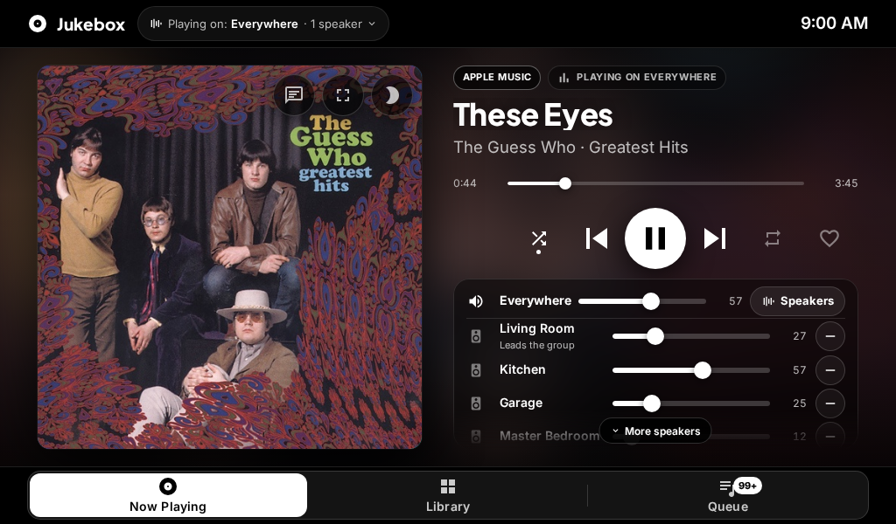
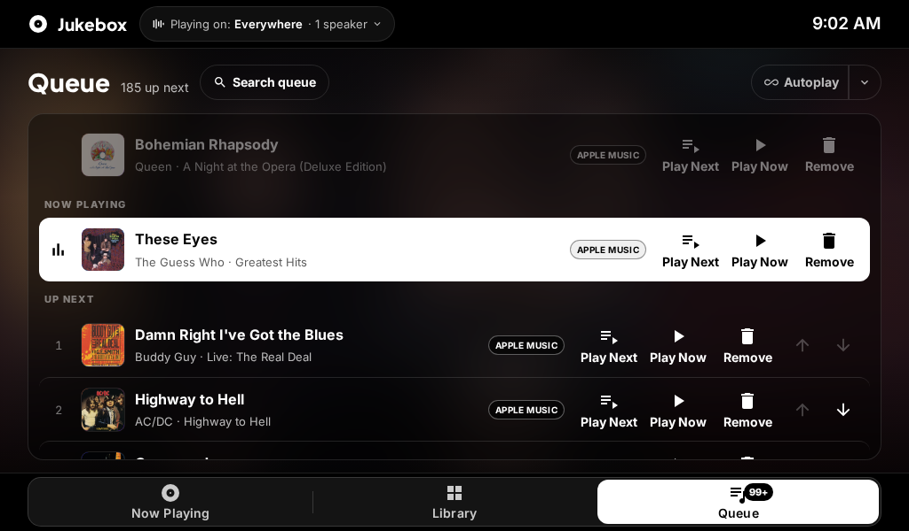

# Jukebox Kiosk (`ha-jukebox-kiosk`) 0.6.4 — DRAFT

> **Draft for 0.6.0.** This README covers the new integration and the card bundled in it. Sections marked *(legacy)* describe the `mass_queue` backend, which still works.

Jukebox Kiosk is a Home Assistant integration that ships the **Jukebox Card**, a Lovelace card for a Home Assistant + Music Assistant jukebox kiosk. It also gives the card its own WebSocket API to Music Assistant, so the card no longer needs [mass_queue](https://github.com/droans/mass_queue).

- **One install.** Setting up the integration serves the card from `/jukebox_kiosk_static/jukebox-card.js` and loads it on every dashboard. You don't add a resource, and you don't unzip fonts.
- **Its own Music Assistant API.** The integration borrows the connection the official Music Assistant integration already holds and exposes it as `jukebox_kiosk/*` WebSocket commands. It forwards only an allowlist of Music Assistant commands, and every one is checked against the calling Home Assistant user (see [Permissions](#permissions)).
- **Every card feature without mass_queue.** Queue reading and editing (Play now, Play next, Move, Remove with Undo), album/artist/playlist/podcast track lists with server-side paging, lyrics, speaker grouping and transfer, and removing favourites.
- **Live queue.** The card subscribes to queue changes (`jukebox_kiosk/subscribe_queue`) instead of polling.

The card's element is still `custom:jukebox-card`, so existing dashboards keep working. Version history is in [CHANGELOG.md](CHANGELOG.md), and building and tests are in [docs/DEVELOPMENT.md](docs/DEVELOPMENT.md).

## Screenshots



| Search | Queue |
|---|---|
|  |  |
| **Browse** | **Screensaver** |
|  |  |

## Requirements

- **Home Assistant 2026.10.0** or newer.
- **[Music Assistant](https://music-assistant.io)** 2.10 or newer, and the official **Music Assistant** integration (`music_assistant`) set up in Home Assistant. Jukebox Kiosk uses that integration's connection, so it has no server URL or token of its own.
- **A Music Assistant player** to play to. Group players such as `media_player.everywhere` work too.
- mass_queue is **not** needed. You can keep it installed: once Jukebox Kiosk is set up, the card uses mass_queue only if you set `backend: mass_queue`.

> **Music licensing and lyrics.** Jukebox Kiosk plays whatever your Music Assistant providers give it; it ships no music and no lyrics. Personal streaming subscriptions are usually for private listening only, so a public or commercial venue (a bar, shop, gym or event) needs music services and performance licenses that cover public playback. Lyrics are fetched live through Music Assistant's metadata providers when you open them; they are never bundled, and the card keeps lyric text in memory only.

## Install

### HACS (custom repository)

1. HACS → ⋮ → **Custom repositories** → `https://github.com/randybell/ha-jukebox-kiosk`, category **Integration**.
2. Install **Jukebox Kiosk**, then restart Home Assistant.
3. **Settings → Devices & services → Add integration → Jukebox Kiosk**, then choose your Music Assistant entry.
4. Add `type: custom:jukebox-card` to a dashboard (see [Configuration](#configuration)).

### Manual

Copy `custom_components/jukebox_kiosk/` (from the repository or the `jukebox_kiosk.zip` release asset) into `/config/custom_components/`, restart, then follow steps 3–4.

### Coming from the old Jukebox Card plugin (0.5.x)

The integration finds dashboard resources that still point at `/hacsfiles/ha-jukebox-kiosk-card/` (or `/local/community/ha-jukebox-kiosk-card/`, where Home Assistant 2026.11's Marketplace serves plugins) and removes them, so the card doesn't load twice. It then raises a Repairs issue that asks you to remove the old **Jukebox Card** plugin in HACS or the Marketplace. The issue stays, also across restarts, until the old plugin files are gone. YAML-mode resources can't be edited automatically; the Repairs issue lists the line to delete. Card configs keep working as they are. `mass_queue_entry_id` is ignored unless you set `backend: mass_queue`.

## Backends

The card talks to Music Assistant through one of three backends. Set `backend` in the card config. The resolved backend is shown on the element as `data-backend`.

| `backend` | Uses | Notes |
|---|---|---|
| `auto` (default) | `kiosk` if `jukebox_kiosk` is loaded; otherwise `mass_queue` if `mass_queue_entry_id` is set or mass_queue is loaded (or the loaded integrations can't be read); otherwise `native` | The 0.5.x behaviour is kept when the integration isn't installed. |
| `kiosk` | `jukebox_kiosk/*` WebSocket commands | Every feature. Controls the server doesn't allow for this user are hidden. |
| `mass_queue` *(legacy)* | `mass_queue.*` services, as in 0.5.x | Needs `mass_queue_entry_id`. Kept for anyone not ready to install the integration. |
| `native` | the official `music_assistant` services only | Search, Browse grid, transport, volume and playing music. No queue tab, track lists, lyrics or grouping. |

On the kiosk backend the card asks `jukebox_kiosk/capabilities` once per connection and hides what the server reports as unavailable: queue icons (`queue_play`, `queue_edit`), Undo, the remove-favourite heart (`unfavorite`), the Speakers panel's grouping (`speakers`) and the Lyrics tab (`lyrics`).

## Permissions

Admins can do everything. In the integration's options (**Settings → Devices & services → Jukebox Kiosk → Configure**, form "Guest permissions") you choose:

- **Guest users**: these users get guest rights even if they are admins. This is handy for a kiosk login.
- **Treat every non-admin user as a guest** (default on): when this is off, non-admins get every class except `admin`.
- **What guests may do**: any of the classes below. `admin` can never be given to guests.

| Class | Allows | Guest default |
|---|---|---|
| `read` | queue, search, browse, lyrics | ✅ |
| `playback` | play and add music, jump in the queue | ✅ |
| `queue` | reorder, remove, undo | ✅ |
| `library` | favourite / unfavourite (the heart on Now Playing and on Search radio results), playlists | ✅ |
| `speakers` | Music Assistant grouping: join / drop speakers (`players/cmd/set_members`), Move (`player_queues/transfer`), stop a group (`players/cmd/stop`) | — |
| `admin` | `jukebox_kiosk/raw` diagnostics | never for guests |

**Volume needs no class.** Volume and mute (the Now Playing sliders and the Speakers panel mixer, in fixed and dynamic mode) are sent as Home Assistant `media_player.volume_set` / `volume_mute` services, not through the integration, so a guest without `speakers` keeps the mixer. Without `speakers` the card hides grouping and the server refuses `set_members`, `transfer` and `stop`.

**Existing entries keep their saved choice.** The defaults apply when the integration is added (they are written into the entry's options) and when the options have no `guest_classes` key at all. An entry that already saved a list, for example one added from an earlier 0.6.0 draft with read, playback, queue and speakers, keeps exactly that list until you change it under **Configure**.

The server enforces these on every command. Hiding a control in the card is a convenience only; the card's own `grouping` option is still not a security boundary.

**Not per user.** Music Assistant passes the Home Assistant user only on search, library listings and `play_media`. Recently played, favourites and recommendations are shared by everyone on the Music Assistant server.

## Checked Music Assistant commands

No allowlisted command in `MA_COMMANDS` (`custom_components/jukebox_kiosk/const.py`) is still marked `TODO-VERIFY`. Each one is confirmed by the `music-assistant-client` signatures, by a live read, or by a read-only check against Music Assistant 2.10.9. `jukebox_kiosk/capabilities` therefore returns an empty `todo_verify` list. The last commands confirmed, all with read-only checks, were:

- **`music/genres/overview`** takes `item_id`, `provider_instance_id_or_domain` (default `library`) and `limit`, which is applied per row (default 25). It returns rows for Artists, Albums, Tracks and Playlists, whose ids are `genre_<type>`.
- **`music/podcasts/library_items`** and **`music/audiobooks/library_items`** take `favorite`, `search`, `limit` (500), `offset` (0), `order_by` (`sort_name`), `provider`, `genre` and `played_only`. They also take the keyword-only arguments `summary` (default true), `collapse_collections` and `reachable_via`. Send `summary: false` when you need `fully_played` and `resume_position_ms`. Both commands pass the Home Assistant user to Music Assistant, like the other library listings.
- **`music/item_by_uri`** is read-only only while `allow_update_metadata` is false, so the integration always sends `false`. It refuses any other value, and it refuses `allow_update_metadata: true` on every allowlisted command. For a track in your library, this command returns the library copy (provider `library`), even when you ask with a provider URI.

**Lyrics.** On the kiosk backend the card never sends a library track to `metadata/get_track_lyrics`, because Music Assistant would write to its library. It uses the provider copy in the queue (`current_item.media_item`) instead. If that isn't there, it looks up each provider mapping with `music/item_by_uri`, without `allow_update_metadata`. If the lookup returns the library copy, the card skips it. The card doesn't fetch from LRCLIB directly, so when it finds no provider copy it shows "No lyrics found". The admin-only `jukebox_kiosk/raw` diagnostic command doesn't go through the allowlist.

## Configuration

> The card reference below was written for 0.5.x. Wherever it names a `mass_queue.*` action, the kiosk backend sends the matching `jukebox_kiosk/*` command instead and behaves the same, except that the server pages track lists 100 at a time. `mass_queue_entry_id` applies only to `backend: mass_queue`.

Add `backend: auto` (the default) or one of the values in [Backends](#backends).

Add the card to a dashboard. A single **panel** view is the layout it is built for. Entity ids in the example are labeled `example:`. Keys you leave out use the defaults in [Options](#options); those defaults are unchanged.

```yaml
# Example configuration. Entity ids below are examples; replace them with yours.
views:
  - title: Jukebox
    path: jukebox
    type: panel
    cards:
      - type: custom:jukebox-card
        entity: media_player.everywhere                # example: Music Assistant group player; every play_media goes here
        config_entry_id: <music assistant entry id>    # Settings → Devices & services → Music Assistant (id is in the URL)
        mass_queue_entry_id: <mass_queue entry id>     # optional, enables album/artist/playlist track lists
        favorite_entity: button.everywhere_favorite_current_song  # example
        rooms:                                         # example
          - { name: Living Room, entity: media_player.living_room }
          - { name: Kitchen,     entity: media_player.kitchen }
          - { name: Garage,      entity: media_player.garage }
        screensaver_minutes: 10
        default_tab: now                               # now | browse | search | queue | lyrics
        show_lyrics: true                              # needs mass_queue_entry_id
        backdrop: auto                                 # full | light | static | off | auto
```

The rest of this section is how each part of the card behaves.

### Backdrop and performance

The full look puts a 38 px live blur of the album art behind the whole centre and a `backdrop-filter` blur behind every panel (14–18 px). That is cheap on a desktop GPU but expensive on low-end kiosk tablets, because the blurred layers have to be re-rastered whenever anything on top of them changes (a slider knob, a key press, a new search result). The `backdrop` option picks a cheaper look:

| `backdrop` | Centre backdrop | Panels (rooms, queue, search results, keyboard) |
|---|---|---|
| `full` | live CSS `filter: blur(38px) saturate(1.15)` of the full-size art | translucent + `backdrop-filter: blur(14–18px)` |
| `light` | the art drawn **once per track change** into a 64 px canvas (downscaled to 10 px, then smooth-upscaled and lightly blurred), stretched by the compositor; no CSS filter | solid `rgba(0,0,0,0.6)`, no `backdrop-filter` |
| `static` | a dark gradient, no art | solid `rgba(0,0,0,0.6)` |
| `off` | pure black | solid `rgba(0,0,0,0.6)` |
| `auto` (default) | `light` if `navigator.hardwareConcurrency <= 4`, or `navigator.deviceMemory <= 2`, or `prefers-reduced-motion: reduce`; otherwise `full` | |

- The resolved mode and the reason are on the element: `<jukebox-card data-backdrop="light" data-backdrop-why="hardwareConcurrency=4">`. Use this to check what a Fully Kiosk tablet picked (Fully's remote admin → "Get page source" or a remote DevTools session).
- `light` needs no CORS: drawing a cross-origin image into a canvas is allowed as long as nothing reads the pixels back, and the card never does. If an image fails to load, the canvas stays hidden and the gradient shows.
- `light` redraws only when the art URL changes or the screen's aspect ratio changes, never on slider drags or key presses (test 15c).
- Theme overrides: `--jb-panel-filter` (default `blur(14px)`, `none` in non-full modes) and `--jb-surface` / `--jb-panel-solid` for the panel colour.
- The screensaver shows the art (unblurred, so no filter cost) in `full` and `light`, and plain black in `static` and `off`.

**Reduced motion.** With `prefers-reduced-motion: reduce` (Android: Settings → Accessibility → Remove animations), `auto` picks `light`, and the screensaver turns off its Ken Burns zoom and its continuous drift. To still protect the panel from burn-in, the clock block jumps to a new position every 60 s with no animation (`step-end`), cycling through 10 spots over 10 minutes.

**Measured** with `node test/perf.mjs 3` in headless Chrome at 1920x1080 with a 4x CPU throttle (CDP `Emulation.setCPUThrottlingRate`), means of 3 runs of about 6.4 s each. Frame times are in ms.

| Scenario | avg | p95 | max | frames >33 ms | long tasks | main-thread ms | raster/GPU ms |
|---|---|---|---|---|---|---|---|
| slider drag, `full` | 16.7 | 16.8 | 16.8 | 0% | 0 | 665 | 190 |
| slider drag, `light` | 16.7 | 16.7 | 16.8 | 0% | 0 | 692 | 175 |
| keyboard typing, `full` | 16.8 | 16.8 | 44.5 | 0.3% | 0 | 1701 | 1438 |
| keyboard typing, `light` | 16.8 | 16.7 | 33.3 | 0% | 0 | 1706 | 407 |


*Top: `full`, `light`. Bottom: `static`, `off`.*

- Frame times are `requestAnimationFrame` deltas; long tasks come from a `PerformanceObserver('longtask')`; main-thread and raster/GPU time come from a CDP trace (`ThreadControllerImpl::RunTask` on the renderer main thread vs. compositor, raster and GPU threads).
- The main thread is not the bottleneck in either mode: no long tasks and a steady ~16.7 ms at 4x throttle. The blur cost is in raster/GPU work, which CPU throttling does not slow down, and on this box's fast CPU it still fits in a frame. The useful number is raster/GPU time, which is where a slow tablet's GPU drops frames. Typing (results re-rendering over a blurred backdrop) costs about 3.5x more raster/GPU time in `full` than in `light`.
- Re-check on the real tablet: open the dashboard with `backdrop: full`, then `light`, and compare how smooth the volume drag and typing feel. If `auto` picked `full` on a weak tablet, set `backdrop: light` explicitly.

### Large screens (1920x1080)

The layout is designed around a 1280x800 tablet. On larger screens the whole card is zoomed (CSS `zoom`, set from a `ResizeObserver`) so the art, text and touch targets grow, rather than spreading out with empty space. At 1920x1080 the zoom is 1.35, which gives the 1280x800 layout's proportions at full resolution. Popover menus correct their position for the zoom (`localRect` in `src/shared.ts`; test 15k). Use `scale: 1` to turn this off, or a number to force a size.

### Now Playing

- **Art.** The card never loads the player's absolute `entity_picture` (`http://<ma-host>:8095/imageproxy?…` is mixed content on an https dashboard and unreachable off the LAN). It uses, in order: `entity_picture_local` (HA's relative `/api/media_player_proxy/…` URL), a relative `entity_picture`, the current mass_queue item's https `media_image`, then the placeholder. The same URL feeds Now Playing, both backdrops (`full` and `light`) and the screensaver. Radio streams with no art get a radio-tower image. Item images are used only when they are https, `data:image` or relative.
- **Display.** The album art is blurred behind the card. The tab shows the art, title, artist · album, a provider badge from the URI scheme and "Playing on Everywhere".
- **Seek bar.** Tap or drag it to send `media_player.media_seek {seek_position}`. The time label follows the drag.
- **Transport.** All transport calls target `entity` only:

  | Button | Call |
  |---|---|
  | Previous | `media_previous_track` |
  | Play / pause | `media_play` or `media_pause`, chosen from the state |
  | Next | `media_next_track` |
  | Shuffle queue | `shuffle_set {shuffle}` on the player the card is playing on (its Music Assistant queue) |
  | Repeat queue | `repeat_set {repeat}` on the same player, toggling off ↔ all; "all" repeats the whole queue. Repeat one is never offered or sent |

  Shuffle and repeat are queue settings: they always go to the active target (the group or player the card is playing on, e.g. Everywhere), never to individual member speakers, and there is no per-track or per-row shuffle or repeat. If the player ever reports repeat "one" (set somewhere else), the card shows it as repeat queue and, with `coerce_repeat_one` on (the default), sends a single `repeat_set {repeat: all}` to that player: once per detection, about 1.5 s after it is seen, at most once a minute, and only for a user with Playback permission. A message is never shown for this.
  Active shuffle and repeat are white with a dot under them; inactive ones are light white. The UI updates optimistically and reconciles when HA reports the new state.
- **Heart.** If the current song isn't a favorite, the heart sends `button.press` to `favorite_entity`. If it already is (from mass_queue's `favorite` flag), it sends `mass_queue.unfavorite_current_item {entity}` (this may only work for library items).
- **Up next strip.** It shows the next queue item and "+ N more". Tapping it opens the Queue tab.
- **Volume:**
  - **Everywhere** sends `volume_set` to the group player.
  - **Each room** sends `volume_set {volume_level}` to **that room's entity only**.
  - Sliders are optimistic: the number follows your finger.
  - While you drag, the card sends at most one call every 200 ms, and always sends the final value on release.
  - Tapping a speaker icon sends `volume_mute {is_volume_muted}` to that entity.
  - The card never joins or unjoins players.
- **Layouts.** In landscape the art is on the left; in portrait it sits on top, with rooms in a three-column grid on tablets. Phone layout applies at ≤520 px.

### Queue

- **Reading.** The queue comes from `mass_queue.get_queue_items {entity, limit_before: 1, limit_after: queue_limit (1–1000)}` with `return_response`. It refreshes when the tab opens, when the track, state or shuffle changes, and after every action.
- **Layout.** The previous track is dimmed. "Now playing" is the highlighted white row, then a numbered "Up next" list. "+ N more in Music Assistant" appears when the queue is longer than the list.
- **Tap a row** to send `mass_queue.play_queue_item {entity, queue_item_id}`.
- **Row buttons.** ↑ and ↓ send `move_queue_item_up` and `move_queue_item_down`; they are hidden on phones. **⋮** or a long-press opens a menu: Play now, Play next (`move_queue_item_next`), Move up, Move down, Remove (`remove_queue_item`). Every action sends exactly `{entity, queue_item_id}`.
- **Header.** The Queue tab badge shows how many items are left.
- **0.5.0 row icons** (for users allowed to group, see `grouping`; guests keep the 0.4 rows). They go through `mass_queue.send_command` with the MA queue id, and fall back to the 0.4 services when `mass_queue_entry_id` is not set:
  - **Play now** (not on the playing row) asks first, "Play this now? The current song will stop.", then sends `player_queues/play_index {queue_id, index: queue_item_id}`. Every Play now (icon, ⋯ sheet, long-press menu, row tap) only moves playback to that item: the queue keeps its items and order, and nothing is replaced, cleared or moved.
  - **Play next** sends `player_queues/move_item {queue_id, queue_item_id, pos_shift: (current + 1) − index}`, no dialog; disabled on the row that is already next, absent on played rows. If MA has already buffered the next track it ignores the move and the card shows MA's order again.
  - **Move up / Move down**: as in 0.4, no dialog.
  - **Remove** (never the playing row or played rows) sends `player_queues/delete_item {queue_id, item_id_or_index: queue_item_id}`, no dialog, and shows "Removed <title>. Undo" for 5 s. **Undo** re-adds the track's URI (`player_queues/play_media {queue_id, media: uri, option: add}`), finds the new row (`player_queues/items`) and moves it back (`move_item`). If it can only be re-added at the end, or not at all, the toast says so.
  - Phones (card ≤ 520 px wide): Play next and Remove stay on the row; **⋯** opens an action sheet with Play now…, Play next, Move up, Move down, Remove. Wider cards show all five icons (44 px targets, right-aligned).
  - Tapping a row and the long-press menu keep the 0.4 behaviour.
  - The track Music Assistant is already loading (the one after the playing track, near its end) can't be moved or removed: those rows have no Play next / Remove and their Move buttons are off. If MA refuses anyway, the toast says "That track is already loading" and the queue reloads.

### Speakers (0.5.0)

- **Header status** ("Everywhere · 3 rooms synced", or "N speakers") opens the Speakers panel. The panel opens in the middle of the card, between the header and the tab bar (so it fits the measured height below the HA toolbar), scrolls when it is taller than that, and closes on a tab tap or the ✕.
- **Fixed mode (default).** The panel is a mixer: one volume slider per room, nothing else. Every call goes to `entity`, exactly as in 0.4.
- **Dynamic mode.** "Play on" chips choose the target (remembered per device); joining, dropping and moving use Music Assistant only: `mass_queue.send_command` with `players/cmd/set_members` and `player_queues/transfer` (never `media_player.join` / `unjoin`). Players are read with `players/all`. A static MA sync group is shown as fixed (no join/drop). Each room shows what it is playing. Presets regroup and set volumes in one tap. Changes are optimistic and time out. Every grouping message (joined, left, Regrouping…, errors, Undo) appears in one small status chip at the top right, under the header clock; it never covers the rest of the card, hides itself after about 4 s, and a new message replaces the old one. **Undo** in the chip works while it shows. Errors use the same chip in an inverted (white) style and stay a little longer. Since 0.6.4 drops happen on tap, with no centred dialog; a question that does need an answer (taking a speaker from another group, or the last room) is asked in the chip with one action button and ✕, and ignoring it does nothing. `confirm_drop: true` brings back the centred dialogs. Any room can be dropped and re-added, including the one that leads the group: the card asks MA to remove it from the group (`players/cmd/set_members` on the group, never an ungroup of the speaker), MA re-forms the group on the other rooms after about 6 s of silence and the queue plays on; the panel says "Regrouping…" until it does. `leader_drop: block` keeps the old behaviour (hand off with Move). The last room in a group can't be dropped (MA would stop and dissolve the group): tapping it shows "<Room> is the last speaker in <Group> · Pause" in the chip; Pause keeps the room and the queue, and "<Group> paused · Undo" resumes. While the group is idle, Join is shown greyed with a hint to start playback first. For dynamic MA groups the panel also offers MA's own default line-up as a "<Group> default" preset. Moving music to another target has a silence of about 5 s on the new target.
- **Permissions are a UI lock, not security.** `grouping` / `grouping_users` / `guest_access` only hide or disable controls in this card. Anyone with dashboard access can still call the same services from elsewhere in Home Assistant. Use HA users and dashboards to restrict access.
- **Quiet hours** cap every volume slider (panel and Now Playing) at `max_volume` during the window; guests only unless `applies: everyone`.
- **Editor:** a Speakers section (mode, targets, grouping, grouping users, guest access, leader drop, presets, quiet hours) and `large_buttons` under Display. A 0.4 config opens without the editor writing any speaker keys.

### Browse

- **Categories:** Playlists, Albums, Artists, Tracks, Radio, Podcasts and Audiobooks, plus a **Favorites** toggle.
  - Each call is `music_assistant.get_library {config_entry_id, media_type, favorite?, limit, offset, order_by}` with `return_response`.
  - At start the card makes one `limit: 1` call per category and **hides the categories that are empty**, such as Radio, Podcasts and Audiobooks when the library has none.
- **Sort chip:** A–Z (`name`), then Recently added (`timestamp_added_desc`), then Recently played (`last_played_desc`). Radio sorts by Popular (`play_count_desc`; `get_library` has no popularity order, so this is your own play count), then A–Z.
- **Layout.** Tile grid with provider badges; tracks show as rows. Pages are cached per category, favorite and sort, and load more on scroll.
- **Tap never plays.** Artists, albums, playlists (and podcasts with mass_queue) open the detail view described under Search, with the same rows, icons and confirmations. Other tiles open a small sheet (Play next, Add to queue, Replace queue…, Start radio…). **Long-press** opens a menu: Open, Play next, Add to queue, Replace queue, Start radio (not shown for radio stations); Replace and Start radio confirm first.
- **Radio.** Browse > Radio lists `get_library {media_type: radio}`. If the library has no stations (Radio Browser stations you haven't saved), it falls back to `music_assistant.search {name: radio, media_type: [radio]}` and says so above the grid. Station names are trimmed (Radio Browser pads some with tabs), every station has a **Radio** badge, and a station with no logo or a dead logo gets a radio-tower image. A tap sends `play_media {media_id: radiobrowser://radio/…, media_type: radio, enqueue: play}` to `media_player.everywhere`, never with `radio_mode`.
- **Drill-down.** The › button on artist, album and playlist tiles, or Open in the menu, opens a detail page:
  - a back button, Play, Shuffle, Add to queue and Start radio (`radio_mode: true`, tracks / artists / albums only), and a track list with per-row icons (tapping a track only highlights it)
  - with `mass_queue_entry_id`, tracks come from `mass_queue.get_album_tracks` / `get_artist_tracks` / `get_playlist_tracks {config_entry_id: <mass_queue entry>, uri[, page]}` with `return_response`. Each row shows its duration, and the header shows the count and total time ("9 tracks · 43 min", with "+" while more pages may follow)
  - playlists are paged: the card asks for `page: 0` first, then `page: 1, 2, …` (0–1000) when you scroll to the end or tap **Load more tracks**. mass_queue 0.10 returns the whole playlist for page 0, so usually there is one call; paging stops on an empty page, a page shorter than the first, or a page that repeats tracks already shown
  - artists also get an Albums row from `music_assistant.search`
  - without `mass_queue_entry_id`, albums and artists fall back to a search, labelled "matched by search", and playlists show a note that mass_queue is needed
- **Search's Open action** jumps to the same detail page.
- **Target.** Every `play_media` goes to the configured player (example: `media_player.everywhere`). Room players are volume targets.

### Screensaver

- **Start.** After `screensaver_minutes` with no touches or keys, a full-screen overlay appears: the current art with a slow Ken Burns zoom, and a big clock, date and the current track, all drifting slowly (240 s loop) to avoid burn-in.
- **Reduced motion.** No zoom and no drift; the clock block jumps to a new spot every 60 s instead.
- **Wake.** A tap wakes it. The tap is swallowed, so it never presses whatever is underneath, and the overlay fades out over 350 ms.

### How search behaves

- **Searches on every keystroke, backspace included, from 1 character.** There is no debounce and no minimum length.
- **The call:**
  ```
  hass.callService('music_assistant', 'search', {config_entry_id, name, limit, media_type: [artist, album, track, playlist, radio, audiobook, podcast]}, undefined, false, true)
  ```
- **Newer results always win.** Every request gets a sequence number, and a reply that is older than the results on screen is dropped. Dropped replies are still cached.
- **No blank flash.** The old results stay on screen until the new ones arrive. A thin hairline under the query bar shows a search is loading.
- **Cache.** Up to 100 queries are kept for 5 minutes (LRU). Backspacing back to an earlier query shows its results instantly, without a new call.
- **Slow Music Assistant.** If a reply takes more than `slow_ms` (800 ms), the card keeps one call in flight and queues only the latest query. Keystrokes in between are merged into that one.
- **Results.** They are grouped as Artists, Albums, Tracks, Playlists, Radio, Audiobooks and Podcasts, with filter chips. **Empty groups and their chips are hidden**, so Radio (when no radio provider answers), Audiobooks and Podcasts don't show. Radio items get a **Radio** badge, a 'Live radio' subtitle, and no Start radio action. Each item has a provider badge taken from its URI scheme, because MA items have no provider field (`library://…` → LIBRARY, `apple_music://…` and `apple_music--XXXXXXXX://…` → APPLE MUSIC).
- **Every result is a list row**: art (round for artists) or an icon, title, subtitle (provider badge, type, artist / album; on phones the track length joins the subtitle). Titles truncate with an ellipsis; rows are at least 56 px tall.
- **Row icons** (48 px, 44 px on phones), each with an `aria-label`:

  | Icon | `play_media` data | Confirmation |
  |---|---|---|
  | Add to queue | `enqueue: add` | none |
  | Play next | `enqueue: next` | none |
  | Replace queue | `enqueue: replace` | "Replace the current queue? This clears what's playing for everyone." Cancel / Replace |
  | Start radio (radio-tower icon) | `enqueue: replace, radio_mode: true` | "Start radio from “…”? This replaces the current queue for everyone." Cancel / Start radio |

  Start radio is shown only for tracks, artists and albums. It is hidden for radio stations, podcasts, episodes, audiobooks and playlists (playlist seeds are not confirmed to work in MA). Nothing is sent until you confirm; Cancel, Esc or tapping outside sends nothing. A second tap on an icon while its call is still on its way is dropped.
  When a row is too narrow for four icons (under about 330 px, e.g. a 320 px phone), Replace and Start radio fold into a **⋯** menu (Replace queue…, Start radio…), which still confirm.
- **Tapping a row never plays.** An artist, album, playlist (or podcast) opens its detail view in place; a track or station row is only highlighted. Long-press does the same.
- **Detail views** (from Search, Browse or Enter on the top result): Back, Play, Shuffle, Add to queue and, where the seed is supported, Start radio. Play and Shuffle replace the queue, so they ask first; Add to queue does not. Tracks, an artist's albums and podcast episodes use the same rows and icons; an album row inside an artist opens that album.
  - **Play** sends `play_media … enqueue: replace`; if the player is shuffling it first sends `media_player.shuffle_set {shuffle: false}` (awaited) so the list plays in order.
  - **Shuffle** sends `media_player.shuffle_set {shuffle: true}` to the player, waits for it, then `play_media … enqueue: replace`. Music Assistant applies the queue's shuffle flag as it loads the new items, so the whole album / playlist / artist plays in random order using documented services only (no client-side reordering of URIs).
  - Track lists come from mass_queue when `mass_queue_entry_id` is set. Without it, albums and artists fall back to a search, labelled "matched by search" with a note; playlists say that mass_queue is needed for their tracks (Play / Shuffle still work).
- **Service call:** `music_assistant.play_media {media_id: <uri>, media_type, enqueue[, radio_mode]}` with target `{entity_id: <entity>}`.
- **Recents.** After a play or opening a detail view, the query is saved to localStorage (`jukebox-card:recents:v1`, up to 8). Tap a chip to search it again; hold a chip 0.7 s to remove it.
- **Hardware keyboard:**

  | Key | Action |
  |---|---|
  | Letters, digits, punctuation | Type (shown uppercase) |
  | Backspace | Delete a character |
  | Esc | Close the confirmation or menu, then leave a detail view, otherwise clear the query |
  | Enter | Open the top result's detail (or highlight a track); never plays |

  Ctrl, Alt and Meta shortcuts are ignored.
- **On-screen keyboard:**
  - 7 columns when narrow, 10 with a number row when wide.
  - `123` / `#+=` switches to symbols.
  - Holding backspace clears the query.
  - Keys fire on release (pointerup), so a touch that slides off a key does not type.
  - In portrait you can hide the keyboard with its handle; a "Keyboard" button brings it back.
- **Focus.** No keyboard ever pops up: there is no input, textarea or contenteditable element anywhere. Every button is `tabindex=-1` and calls `preventDefault` on pointerdown, except the active bottom tab (0.5.0), which is the tab bar's one keyboard stop: ←/→/Home/End switch tabs. A focusin guard blurs anything editable.


**Radio, audiobooks and podcasts.** These groups (and their filter chips) are hidden whenever they come back empty. With Radio Browser in Music Assistant, stations appear in search results (`radiobrowser://radio/<uuid>`) and in Browse > Radio. Try it in the harness with `?radio=1` or `?radio=lib`.

### Lyrics

Lyrics come from Music Assistant's own metadata (its LRCLIB provider, with Genius as an optional fallback) through **mass_queue**, so `mass_queue_entry_id` is required; without it the lyrics surfaces say "Lyrics unavailable".

- **Lookup.** `mass_queue.send_command {config_entry_id: <mass_queue entry>, command: "music/item_by_uri", data: {uri}}` with `return_response`; lyrics are read from `metadata.lrc_lyrics` / `metadata.lyrics`. If both are empty the card calls `metadata/get_track_lyrics {track: <item>}`, which answers `[plain, lrc]` (`[null, null]` = not found). The reply shape is `{response: {response: …}}`. The first lookup of a song can take 8–33 s (LRCLIB rate limit); the card waits up to 60 s.
- **Radio.** For a station, the card searches `music/search` for the stream's artist + title, takes the best track match (exact title first, then prefix; "(Live)" / "Remastered" variants rank below the plain title) and asks `get_track_lyrics` for it. Radio lyrics never seek.
- **Surfaces** (all share one store, so a song is looked up once):
  - **Art overlay**: the lyrics toggle at the top right of the art; remembered per device (`localStorage`, `jukebox-card:lyrics-overlay:v1`).
  - **Stage**: the expand button next to it opens a full-screen lyrics view (Fullscreen API, WebKit fallback, or a fixed overlay where fullscreen is not allowed). Tap to show the transport controls and ✕; Esc or ✕ closes it.
  - **Lyrics tab**: the 5th tab (`lyrics_tab`).
  - **Screensaver**: previous / current / next line for synced lyrics, a slow scroll for plain lyrics (`screensaver_lyrics`). With no lyrics to show, a small translucent status line ("No lyrics", "Lyrics unavailable", "Looking for lyrics…") sits under the track info and drifts with the clock.
- **Synced lyrics** highlight the current line from the interpolated player position (plus `lyrics_offset_ms`) and keep it centred. **Long-press** a line for 0.55 s to send `media_player.media_seek {seek_position}` to `entity`; the line flashes and a toast confirms it. A plain tap does nothing, so scrolling never seeks.
- **Plain lyrics** scroll in proportion to the track's progress and show an **Unsynced** chip. Scrolling by hand pauses the auto-scroll for a few seconds.
- **States**: "Looking for lyrics…", "No lyrics found", and "Lyrics unavailable" (with Try again; a permission error adds a note that the HA user may need admin rights for `mass_queue.send_command`). Failures back off for 60 s; there is never more than one lookup per song in flight.
- **Lyrics come only from Music Assistant.** The card fetches and displays them through Music Assistant and never stores or redistributes lyric text. Lyric text stays in memory (an LRU of 50 songs) for the page session only, and a reload fetches it again. `localStorage` (`jukebox-card:lyrics:v2`, 100 songs, keyed by URI or by `artist|title` for radio) only remembers "not found" markers, with no text, for 1 day. The old `jukebox-card:lyrics:v1` cache, which held lyric text, is deleted on load.
- **Look**: Black Frame Mono: the current line is white, the others translucent white, over whatever `backdrop` mode is active.

## Options

Entity ids in the [configuration example](#configuration) are examples. The defaults in this table are the card's defaults.

| key | default | |
|---|---|---|
| `entity` | `media_player.everywhere` | Player for transport, the Everywhere volume, the queue and every `play_media` |
| `config_entry_id` | (required) | MA config entry for `music_assistant.search` / `get_library` |
| `rooms` | `[]` | `[{name, entity, icon?}]`, or bare entity ids (the name then comes from `friendly_name`). Each room gets its own volume slider |
| `favorite_entity` | `button.everywhere_favorite_current_song` | Pressed by the heart (button, input_button or script). `''` hides the heart |
| `backend` | `auto` | `auto`, `kiosk`, `mass_queue` or `native` (see [Backends](#backends)) |
| `mass_queue_entry_id` | — | *(legacy, `backend: mass_queue` only)* mass_queue (Music Assistant Queue Actions) config entry, used for `mass_queue.get_album_tracks / get_artist_tracks / get_playlist_tracks` and for lyrics (`mass_queue.send_command`). The 0.3.0 name `queue_config_entry_id` is still accepted, and the visual editor rewrites it to the new key |
| `screensaver_minutes` | `10` (0–1440) | Idle minutes before the screensaver. `0` turns it off. The editor offers Off, 1, 5, 10, 15, 30, 60 and Custom; any 0–1440 value from YAML still loads |
| `browse_limit` | `60` (1–500) | Items per Browse page (infinite scroll pages by `offset`) |
| `queue_limit` | `200` (1–1000) | Upcoming items requested from `get_queue_items` (`limit_after`); out-of-range values are clamped |
| `limit` | `8` (1–50) | Search results per type. 1-character queries always use 5 |
| `default_tab` | `now` | `now`, `browse`, `search`, `queue` or `lyrics`. A tab that is turned off (or unknown) is ignored and Now Playing opens |
| `library_only` | `false` | Search only the MA library |
| `search_filters` | `true` | v0.7 filters. An artist page in Search offers **Search in JJ Grey** (an album page: **Search in** that album); the next searches stay inside it, shown as a removable chip (`Artist: JJ Grey ✕`) with **Clear filters**. Library gets a **Filter** button (type to narrow the list) and **Filter by** on artist pages (that artist's albums / tracks). `false` hides all of it |
| `idle_clear_filters` | `true` | When the screensaver comes on (`screensaver_minutes`), the Search scope chips (`Artist: … ✕`) and the Library filters are cleared, so the next person starts from everything. `false` keeps them until ✕ / Clear filters |
| `library_first` | `true` | Search lists your library matches first ("In your library"), then provider results ("From your providers") with copies of library items removed. Applies to scoped searches too. `false` keeps Music Assistant's order |
| `slow_ms` | `800` | Search replies slower than this switch on in-flight limiting |
| `accent` | `mono` | Only `mono` exists so far |
| `font_base` | `fonts/` next to the `.js` | Location of the woff2 files. `false` uses system fonts |
| `height` | fits the window | Card height. By default the card fills the space from its top edge to the bottom of the window (below the HA toolbar, minimum 320 px); set a fixed value such as `700px` to override |
| `backdrop` | `auto` | `full`, `light`, `static`, `off` or `auto`. See [Backdrop and performance](#backdrop-and-performance) |
| `scale` | `auto` | Large-screen zoom. `auto` scales the whole UI by min(width/1420, height/800) once that is ≥ 1.15 (1920x1080 → 1.35, capped at 1.8). A number forces it; `1` turns it off |
| `title` | `Jukebox` | Brand text in the header |
| `show_lyrics` | `true` | Master switch for lyrics: art overlay toggle, Stage, Lyrics tab and screensaver lyrics. Needs `mass_queue_entry_id` |
| `lyrics_tab` | `true` | Show the 5th **Lyrics** tab |
| `screensaver_lyrics` | `true` | Previous / current / next line (synced) or a slow scroll (plain) on the screensaver |
| `lyrics_seek` | `true` | Long-press (0.55 s) a synced line to seek there. Never on radio |
| `lyrics_offset_ms` | `500` (−5000–5000) | Shift for synced lyrics; positive shows lines sooner |
| `speaker_mode` | `fixed` | `fixed`: always play on `entity`; the Speakers panel is a volume mixer and a 0.4 config makes exactly the same calls. `dynamic`: pick where to play, group, move and use presets. See [Speakers](#speakers-050) |
| `targets` | all MA players | `dynamic` only: `[{entity, name?, members?}]` or entity ids the card may play on |
| `grouping` | `admins` | Who may group, move, pick the target and use the queue's Play now / Play next / Remove icons: `admins`, `everyone` or `nobody`. **A UI lock, not security** |
| `grouping_users` | `[]` | Extra users (name or user id) treated like admins for the above |
| `guest_access` | `volume` | Everyone else in the Speakers panel: `volume` or `none` (read only) |
| `leader_drop` | `allow` | Dropping the leader of a playing group: `allow` (MA re-forms the group on the other rooms after about 6 s of silence; the panel shows "Regrouping…"), or `block` (hand off with Move) |
| `coerce_repeat_one` | `true` | A player that reports repeat "one" is switched back to repeat all (the whole queue) with one `media_player.repeat_set`, once per detection with a one-minute cooldown, only for the card's active player and only for users with Playback. `false` sends nothing (repeat "one" is still shown as repeat queue, and the card never offers it) |
| `confirm_drop` | `false` | `true` asks in a centred dialog before a drop, a takeover or pausing the last room (the 0.6.3 behaviour). `false` (default) drops on tap and shows a small status chip top-right with Undo; a takeover or last-room question is asked in the chip |
| `presets` | `[]` | `[{name, members: [room entities], volumes?: {entity: percent}, target?}]` (`dynamic`) |
| `quiet_hours` | — | `{start: 'HH:MM', end: 'HH:MM', max_volume: percent, applies?: guests\|everyone}` caps volume sliders; `start === end` means all day. Guests only by default |
| `large_buttons` | `false` | Bigger touch targets and text everywhere |
| `search_categories` | unset | *(0.7, off by default)* Search category chips, in order: `tracks`, `artists`, `albums`, `playlists`, `radio`, `podcasts`, `audiobooks`, `genres`. Unset keeps the 0.6 search. `genres` needs the Jukebox Kiosk backend |
| `search_default_category` | `all` | *(0.7)* Chip selected when Search opens |
| `discover` | off | *(0.7)* `true` or a list of Music Assistant recommendation rows (`recently_played`, `favorite_radio`, `provider:item_id`, ...) shown as a **Discover** chip on Browse. Jukebox Kiosk backend only |
| `radio_browse` | off | *(0.7)* `true` or a list of `popular`, `country`, `language`, `tag`: "Stations by" modes on Browse → Radio (Radio Browser provider). Hidden on the native backend |
| `radio_country` | HA's country | *(0.7)* Two-letter code the Country mode opens on |

The visual editor covers entity, config entry, rooms (an entity list that keeps existing names), favorite entity and mass_queue entry; a **Display** section (screensaver presets Off / 1 / 5 / 10 / 15 / 30 / 60 min plus Custom, screensaver lyrics, default tab, backdrop, accent); a **Lyrics** section (lyrics, Lyrics tab, long-press seek, offset); and an Advanced section (browse limit and the rest). Options you leave at their defaults are not written to YAML, and existing 0.3.x configs load unchanged.


## Troubleshooting

- **The card says "Custom element doesn't exist: jukebox-card".** Make sure Jukebox Kiosk is set up (not only installed), then reload the browser. Fully Kiosk may need **Clear cache**.
- **The card loads twice, or shows the old version.** An old `/hacsfiles/ha-jukebox-kiosk-card/` (or `/local/community/ha-jukebox-kiosk-card/`) resource is still there. See the Repairs issue, or delete it under **Settings → Dashboards → Resources**.
- **Queue icons, the heart or grouping are missing for one user.** That user is a guest without the matching class (see [Permissions](#permissions)).
- **Lyrics say "Lyrics unavailable".** Music Assistant has no lyrics provider enabled, or the user lacks `read`. Music Assistant won't fetch lyrics for library tracks, so the card asks for the provider copy of the track.
- **No album art.** The card never loads the player's absolute `entity_picture` (mixed content on https). It uses `entity_picture_local`, then a relative `entity_picture`, then an https queue image.
- **Typing or volume drags stutter on a kiosk tablet.** Set `backdrop` to `light`, `static` or `off`.
- *(legacy)* **On `backend: mass_queue` the Queue tab says "Queue unavailable".** mass_queue isn't installed, or `mass_queue_entry_id` is wrong. It must be the mass_queue entry, not the Music Assistant one.

## License

[MIT License](LICENSE). Copyright (c) 2026 Randy Bell.

The bundled fonts (Inter and Plus Jakarta Sans) are SIL Open Font License 1.1, and the icon path data is Apache-2.0 (Google Material Icons), not MIT. Their `LICENSE-*.txt` files ship in `custom_components/jukebox_kiosk/www/fonts/`. [THIRD_PARTY_NOTICES.md](THIRD_PARTY_NOTICES.md) lists everything bundled, with full license texts.

### Credits

- **[Music Assistant](https://music-assistant.io)** ([GitHub](https://github.com/music-assistant)) does the real work: library, players, search, queue and metadata. Jukebox Kiosk talks to it through the official [Home Assistant integration](https://www.home-assistant.io/integrations/music_assistant/) and [music-assistant-client](https://github.com/music-assistant/client).
- **[Home Assistant](https://www.home-assistant.io)**: the platform and dashboard.
- **Lyrics**: [LRCLIB](https://lrclib.net) (and optionally [Genius](https://genius.com)) are Music Assistant metadata providers. Music Assistant fetches the lyrics, and neither the integration nor the card contacts them. Lyrics remain the copyright of their owners.
- **Inspiration**: [mass_queue](https://github.com/droans/mass_queue) (Music Assistant Queue Actions) by [droans](https://github.com/droans), which powered the card up to 0.5.x and shaped this API, and **Kiosk MA Cards**. No code from either is included.
- **[Lit](https://lit.dev)** by Google LLC, BSD-3-Clause, is bundled into `jukebox-card.js`.
- **Icons**: the UI glyph paths come from, or are adapted from, [Google Material Icons](https://github.com/google/material-design-icons) (Apache-2.0); see [THIRD_PARTY_NOTICES.md](THIRD_PARTY_NOTICES.md).
- **Fonts** (OFL-1.1, via [Fontsource](https://fontsource.org)): [Inter](https://rsms.me/inter/) by Rasmus Andersson and The Inter Project Authors, and [Plus Jakarta Sans](https://github.com/tokotype/PlusJakartaSans) by Tokotype and The Plus Jakarta Sans Project Authors.

This project is not affiliated with or endorsed by Music Assistant, Home Assistant, WiiM, Apple or Genius. All trademarks belong to their owners.
